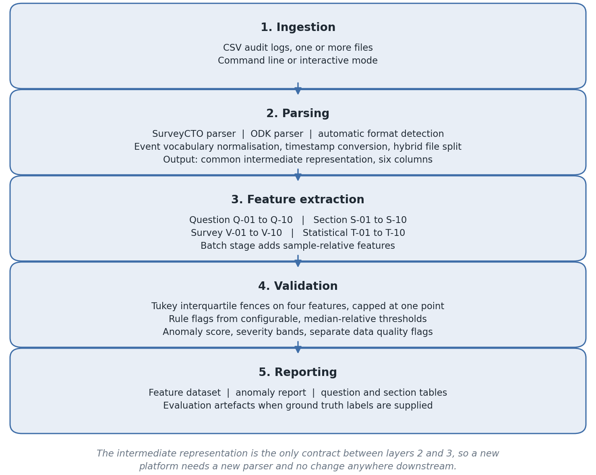
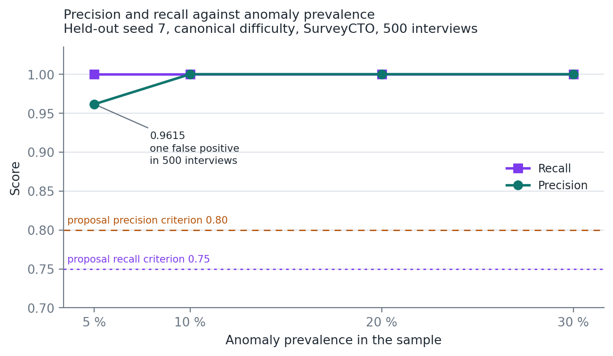
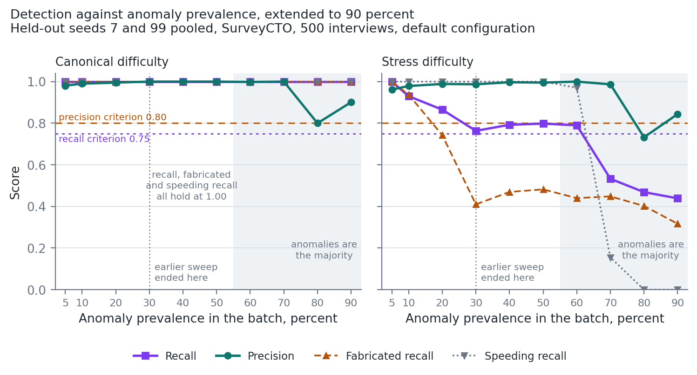

# Automated Extraction and Analysis of Timing-Based Paradata Features for Survey Quality Assurance

**Samuel Kaoma**
Student number 2022016530

Final Year Project Report, Academic Year 2026
A report submitted in partial fulfilment of the requirements for the degree of Bachelor of Science in Computer Science (CSC 4004)
Supervisor: Mr. Mofya Phiri

21 October 2026

Repository: https://github.com/Samuelkaoma-eng/SKACE-TIME-DATA
Validated state: tag `v-final-release` (commit `39cdcc9e2626ecee215fa6f65d9f7a69ea56e323`)

---

## Declaration

I declare that this report is my own work. It has not been submitted, in whole
or in part, for any other award at this or any other institution, and every
source I have drawn on is acknowledged in the reference list.

The use of artificial intelligence tools during this project is disclosed in
full in Appendix A, which records what each tool was used for, what was given to
it, and what I accepted, modified or rejected as a result. All evaluation data
in this study is synthetic and machine generated. No respondent data, and no
data of any kind belonging to a third party, was uploaded to any external tool
at any point.

Signed: ......................................    Date: 21 October 2026

---

## Supervisor approval

I have read this report and approve it as meeting the requirements of CSC 4004
Project for the degree of Bachelor of Science in Computer Science.

Supervisor: Mr. Mofya Phiri

Signature: ......................................    Date: ......................

---

## Acknowledgements

I thank my supervisor, Mr. Mofya Phiri, for reading every draft of this report
closely and for reviews that made it stricter than it would otherwise have
been. I also thank the Department of Computing and Informatics for the
framework within which the project was carried out.

---

## Conventions used in this report

Precision, recall and F1 are quoted to **four decimal places whenever a single
measured run or detector component is named**, in prose and in tables alike,
so that values such as 0.9570 and 0.9615 stay distinguishable rather than both
collapsing to 0.96. Two decimal places are used for three things only: a range
spanning several runs, as in precision between 0.96 and 1.00; the proposal's
success criteria of 0.80 and 0.75, which were fixed at that precision; and
per-class recall, which is always accompanied by the exact counts it derives
from, as in 93 of 132 at 0.70. Counts are exact throughout. Effect sizes
follow the same rule as the primary metrics and are quoted to four decimal
places, so that features whose effects differ only in the third decimal remain
distinguishable. Runtimes are wall clock seconds for a single named run, and
the run is always named. Feature identifiers of the form Q-01, S-01, V-01 and
T-01 are stable across the code, the output datasets and this report.

---

## Table of Contents

| Section | Title | Page |
|---|---|---|
|  | Declaration | 2 |
|  | Supervisor approval | 2 |
|  | Acknowledgements | 2 |
|  | Conventions used in this report | 3 |
|  | List of abbreviations | 6 |
|  | Abstract | 7 |
| 1 | **Introduction** | 8 |
| 1.1 | Problem statement | 9 |
| 1.2 | Aim | 9 |
| 1.3 | Objectives | 9 |
| 1.4 | Scope | 10 |
| 1.5 | Stakeholders and requirements | 10 |
| 1.6 | Contributions | 12 |
| 1.7 | Structure of the report | 12 |
| 2 | **Literature Review** | 13 |
| 2.1 | Paradata and total survey error | 13 |
| 2.2 | Response time and satisficing | 14 |
| 2.3 | Detecting interviewer falsification | 15 |
| 2.4 | Paradata in field and low-resource survey settings | 17 |
| 2.5 | Outlier detection on skewed data | 18 |
| 2.6 | Evaluation on synthetic and imbalanced data | 20 |
| 3 | **Methodology** | 20 |
| 3.1 | Common intermediate representation | 21 |
| 3.2 | Feature taxonomy | 23 |
| 3.3 | Key statistical formulations | 24 |
| 3.4 | Anomaly detection | 25 |
| 3.5 | Computational considerations | 28 |
| 3.6 | Ethical considerations and AI usage disclosure | 28 |
| 4 | **Implementation** | 28 |
| 5 | **Evaluation Methodology** | 31 |
| 5.1 | Synthetic data generation | 31 |
| 5.2 | Design against overfitting | 33 |
| 5.3 | Datasets | 34 |
| 5.4 | Metrics and baselines | 34 |
| 6 | **Results** | 35 |
| 6.1 | Canonical suite | 35 |
| 6.2 | Feature validity | 35 |
| 6.3 | Baseline comparison and component contribution | 37 |
| 6.4 | Class imbalance sweep | 39 |
| 6.5 | Held-out stress evaluation | 42 |
| 6.6 | Detection by anomaly type | 44 |
| 6.7 | Scalability and regression checks | 46 |
| 7 | **Discussion** | 48 |
| 8 | **Limitations** | 52 |
| 9 | **Conclusion** | 54 |
| 9.1 | Evaluation against the objectives | 55 |
| 9.2 | Reflection | 56 |
|  | References | 57 |
| A | **Appendix A. Artificial intelligence usage disclosure** | 60 |
| B | **Appendix B. Per-run confusion counts** | 69 |
| C | **Appendix C. Full feature validity results** | 70 |
| D | **Appendix D. Reproduction commands** | 73 |
| E | **Appendix E. Reference verification record** | 77 |
| F | **Appendix F. Feature-to-source map** | 102 |

## List of Tables

| Table | Title | Section | Page |
|---|---|---|---|
| 1 | Feature taxonomy, forty catalogued features in four groups | 3.2 | 23 |
| 1a | Detector flags and default thresholds | 3.4 | 25 |
| 1b | Synthetic generator parameters | 5.1 | 32 |
| 2 | Ten largest feature effects, n500 SurveyCTO benchmark | 6.2 | 36 |
| 3 | Full detector against two baselines representing current practice | 6.3 | 37 |
| 4 | Contribution of each detection component, aggregated over ten runs | 6.3 | 38 |
| 5 | Class imbalance sweep, held-out seed 7 | 6.4 | 39 |
| 5a | Detection against prevalence, extended to ninety percent | 6.4 | 40 |
| 6 | Held-out stress evaluation, seeds 7 and 99 in both formats | 6.5 | 42 |
| 6a | Both baselines on the held-out stress runs | 6.5 | 43 |
| 6b | One generated history written into both formats | 6.5 | 44 |
| 7 | Per-class recall by injected anomaly type | 6.6 | 45 |
| 8 | Scale behaviour, strict examiner audit | 6.7 | 47 |
| 8a | Peak resident memory by dataset | 6.7 | 47 |
| 9 | Evaluation against the six objectives | 9.1 | 55 |
| A1 | Artificial intelligence tool use, by episode | A.4 | 62 |
| B1 | Confusion counts per run, robustness round | B.1 | 69 |
| B2 | Confusion counts aggregated by platform format | B.2 | 69 |
| C1 | Mann-Whitney U results for all forty features | C | 70 |
| E1 | Verification of every reference, including those withdrawn | E | 77 |
| E2 | Candidate sources for section 2, not yet cited | E | 101 |
| F1 | Source for each of the forty features | F | 102 |

## List of Figures

| Figure | Title | Section | Page |
|---|---|---|---|
| 1 | Five-layer pipeline architecture | 4 | 29 |
| 2 | Precision and recall against anomaly prevalence | 6.4 | 40 |
| 3 | Detection against anomaly prevalence, extended to ninety percent | 6.4 | 41 |

## List of abbreviations

| Abbreviation | Meaning |
|---|---|
| AI | Artificial intelligence |
| CAI | Computer-assisted interviewing |
| CRISP-DM | Cross-Industry Standard Process for Data Mining |
| CSV | Comma-separated values, the file format of both platforms' exports |
| DOI | Digital Object Identifier |
| F1 | Harmonic mean of precision and recall |
| FN, FP, TN, TP | False negative, false positive, true negative, true positive |
| GPS | Global Positioning System |
| IQR | Interquartile range, the distance between the first and third quartiles |
| ISBN | International Standard Book Number |
| ISO 8601 | The international standard for writing dates and times as text |
| JSON | JavaScript Object Notation |
| ms | Milliseconds |
| ODK | Open Data Kit, the collection platform whose mobile client is ODK Collect |
| PDF | Portable Document Format |
| Q1, Q3 | First and third quartiles |
| Q-, S-, V-, T- | Prefixes of the question-level, section-level, survey-level and statistical feature identifiers (Table 1) |
| SMOTE | Synthetic Minority Over-sampling Technique |
| URL | Uniform Resource Locator |

---

## Abstract

Digital data collection platforms such as SurveyCTO and ODK Collect record paradata alongside every interview: timestamps, navigation events and validation errors that describe how an interview was conducted rather than what was answered. Survey methodology research has shown that such timing data can expose falsified interviews and speeding, yet the raw logs differ across platforms, and turning them into comparable interview-level indicators is left to each survey team. This study designed, implemented and evaluated an automated pipeline that parses SurveyCTO and ODK audit logs into a common intermediate representation, computes forty timing-based features at question, section and survey level together with a statistical characterisation of each response time distribution, and flags anomalous interviews using interquartile range thresholds combined with transparent, configurable rules. It was evaluated on synthetic datasets with labelled injected anomalies, generated from held-out random seeds and including a stress condition in which normal and anomalous behaviour overlap. Across a sweep from five to thirty percent anomaly prevalence the detector achieved precision between 0.96 and 1.00 with full recall, and on the held-out stress datasets precision between 0.96 and 1.00 and recall between 0.84 and 0.89, exceeding the predefined criteria of 0.80 and 0.75. Both criteria held at every prevalence up to fifty percent but not beyond, because the thresholds are estimated from the batch they judge, so the method assumes that anomalies are a minority of the batch. A duration-only check representing current practice recovered 66 of 100 anomalies on the canonical benchmark and none of 400 under stress. When the same interviews were written in both formats, every feature and every detector decision was identical. Under stress, speeding was detected in all 132 cases, disengagement in 121 of 136 and mild fabrication in 93 of 132, a shortfall that a diagnostic pass traced to threshold calibration rather than to missing signal.

**Keywords:** paradata; survey data quality; audit logs; interviewer falsification; response time; anomaly detection; interquartile range; SurveyCTO; ODK

## 1. Introduction

The quality of survey data underpins research, policy formulation and decision making in public health, economics and the social sciences (Groves et al., 2009). Digital data collection platforms have substantially improved the efficiency of field survey administration, and two of the most widely deployed platforms, SurveyCTO and Open Data Kit (ODK), automatically record auxiliary process data (Couper, 1998, p. 44), now commonly called paradata (Kreuter, 2013). Paradata captures how an interview unfolded: when each question was opened and answered, how long the enumerator paused, whether answers were revised, and how the respondent navigated through the instrument.

These behavioural traces carry diagnostic value that conventional quality checks cannot match. Unusually fast completion may indicate speeding or fabricated interviews (Bushery et al., 1999, p. 317; Zhang and Conrad, 2014), longer than average response times signal extra processing in one or more stages of answering (Yan and Tourangeau, 2008, p. 56), and atypical navigation patterns may point to satisficing, in which respondents or enumerators invest only the minimum effort required to move forward (Krosnick, 1991). Despite this potential, paradata is routinely underused. Audit logs from SurveyCTO and ODK differ in structure, field naming and timing granularity, and turning millions of raw event rows into defensible quality indicators is left to each survey team.

### 1.1 Problem statement

Existing survey quality assurance practice relies largely on aggregate indicators, chiefly total interview duration, together with manual back-checking of a sample of interviews. Interview duration is an established falsification indicator (Bushery et al., 1999; Bredl et al., 2012), but falsifiers score inconsistently on any single indicator, so combining many is the sounder strategy (Schwanhäuser et al., 2022). A total duration cannot see irregularities that occur within the interview, such as uniform pacing across questions of very different complexity, or timing that is compressed and unusually consistent across an interview; section 6.3 measures how much a duration check misses. The raw material needed to detect these patterns is already collected. ODK Collect can attach an audit log of timestamped question views, jumps and form events to every submission (ODK, n.d.), and SurveyCTO records per-field timing in its text audits (SurveyCTO, n.d.-a). SurveyCTO also offers quality tools of its own, including a minimum time per field with a count of speed violations, and automated checks that warn about quality concerns in incoming data (SurveyCTO, n.d.-b). What neither platform provides is a common set of timing features computed the same way for both, combined into an interview-level score that names the signals that fired and uses thresholds suited to the positively skewed distributions typical of response times (Yan and Tourangeau, 2008, p. 52). That gap, rather than an absence of data or of any tooling, is what this project addresses.

### 1.2 Aim

The aim of this project was to design and implement an automated pipeline for extracting, cataloguing and analysing timing-based paradata features from SurveyCTO and ODK audit logs in order to support scalable survey data quality assessment.

### 1.3 Objectives

1. To review and catalogue timing-based quality indicators identified in survey methodology literature, mapping prior findings to a structured feature taxonomy.
2. To develop format-aware parsers for SurveyCTO and ODK audit logs that produce a common intermediate representation.
3. To implement a feature extraction module computing thirty to fifty timing-based indicators across question, section and survey levels of granularity.
4. To compute statistical characterisation measures including variance, entropy, skewness and kurtosis.
5. To implement anomaly detection using interquartile range thresholding and rule-based logic, validated against precision and recall criteria.
6. To generate structured output datasets, feature documentation and a paradata format guide suitable for reuse by survey researchers.

### 1.4 Scope

The project processes audit logs from SurveyCTO and ODK, extracts forty timing-based and behavioural features, characterises response patterns statistically, applies interquartile range and rule-based anomaly detection, and validates the system empirically using synthetic datasets with labelled anomalies. Real-time monitoring, dashboard integration, machine learning deployment and primary data collection were excluded from scope at proposal stage and remain so. A review dashboard that presents the pipeline's output, live at paradata.samuelkaoma.dev, was built afterwards, on 18 October 2026, as a demonstration of the operating procedure proposed in section 7. It sits outside the evaluated work: every result, count and command in this report describes the tag `v-final-release`, and the dashboard and the five tests added with it, in `tests/test_results_site.py`, are on later commits of `main`.

### 1.5 Stakeholders and requirements

The proposal stated its requirements implicitly, through its aim, objectives, scope and evaluation criteria. They are set out explicitly here, each with its source in the proposal, and section 9.1 evaluates the work against the objectives they derive from.

Four groups have an interest in the system. **Field supervisors** receive the anomaly report and decide which interviews to back-check; they need to see why an interview was flagged, and their review capacity is limited, so every false alarm costs them time. **Survey teams**, including the data managers who receive uploads, run the pipeline on incoming audit logs, choose its thresholds and pass its outputs on; they need it to accept either platform's exports and to run without specialist intervention. **Enumerators** are the people whose work a flag concerns. They do not operate the system, but they bear the cost of every false positive, which is why explainability and precision carry weight in the requirements below. **Survey researchers** reuse the feature library, its documentation and the labelled datasets.

The functional requirements are these.

- **FR1.** Ingest SurveyCTO and ODK audit logs as CSV files, detecting the format automatically, including files in which both platforms' rows have been concatenated (proposal sections 1.4 and 3.2; Objective 2).
- **FR2.** Normalise every input into one common intermediate representation, marking malformed rows rather than discarding them silently (proposal section 3.2).
- **FR3.** Compute thirty to fifty timing-based features at question, section and survey level (Objective 3).
- **FR4.** Characterise each interview's response time distribution by its variance, entropy, skewness and kurtosis (Objective 4).
- **FR5.** Flag anomalous interviews using interquartile range fences and rule-based thresholds, giving each interview a score, a severity category and the list of flags that fired (Objective 5; proposal section 3.3).
- **FR6.** Evaluate detection against labelled ground truth, reporting precision, recall and F1 overall, by anomaly type and by detection component (proposal section 5).
- **FR7.** Generate synthetic audit logs in both formats with labelled injected anomalies of each type (proposal section 5.1).
- **FR8.** Write the feature dataset, the anomaly report and the question-level and section-level tables as structured files, accompanied by feature documentation and a paradata format guide (Objective 6; proposal section 4).

The non-functional requirements are these.

- **NFR1. Detection quality.** Precision of at least 0.80 and recall of at least 0.75 for the combined detector (proposal section 5).
- **NFR2. Explainability.** Every flag is a named rule or fence that a supervisor can check, and no opaque model is used (proposal section 3.3).
- **NFR3. Extensibility.** Supporting a further platform requires a new parser and no change downstream (proposal section 3).
- **NFR4. Scalability.** Processing cost grows approximately linearly with the number of audit events, from pilot studies to surveys of thousands of interviews (proposal section 3.3.1).
- **NFR5. Configurability.** Every threshold can be changed without changing code, because thresholds drawn from the literature may not transfer between instruments (proposal section 8).
- **NFR6. Reproducibility.** Every reported result can be regenerated from recorded seeds and documented commands, and the code is covered by automated tests (proposal sections 3.4 and 4).
- **NFR7. Privacy.** The system processes paradata only, never survey answers, and validation uses synthetic data (proposal section 3.5).

### 1.6 Contributions

This work makes four contributions. The first is a format-agnostic intermediate representation for survey paradata, a six-column normalisation of SurveyCTO and ODK audit logs that decouples every downstream component from platform specifics, so that supporting an additional platform requires a new parser and no change to the feature library, the detector or the reporting layer. The second is a documented and tested feature library of forty timing-based indicators with stable identifiers spanning question, section and survey granularity together with a statistical characterisation of each interview's response time distribution, released with a coverage table that states for every feature where it is implemented, whether the pipeline exported it, and how it is tested. The third is a like-for-like baseline comparison, in which the full detector and two methods representing current practice are computed from the same raw files, the same features and the same ground truth inside a single audited script, so that the improvement over aggregate-duration checking is measured rather than asserted. The fourth is an evaluation designed to fail: held-out seeds, a stress difficulty in which normal and anomalous profiles overlap by construction, a class prevalence sweep, and a component breakdown that isolates and reports the weaker half of the author's own detector.

### 1.7 Structure of the report

Section 2 reviews the literature in five themes: paradata and total survey error, response time and satisficing, falsification detection, paradata in low-resource field collection, and outlier detection on skewed data. Section 3 sets out the methodology, including the common intermediate representation, the forty-feature taxonomy and the detector with its default thresholds. Section 4 describes the implementation and the defects found and fixed during development. Section 5 describes the synthetic data generator, the safeguards against overfitting, the datasets and the baselines, and section 6 reports the results. Section 7 discusses what the results support and what they do not, section 8 states the limitations, and section 9 concludes with an evaluation against the six objectives and a reflection on the project. The appendices give the disclosure of artificial intelligence use (A), per-run confusion counts (B), the full feature validity results (C), the reproduction commands (D), the record of reference verification (E) and the map from each feature to its source (F).

## 2. Literature Review

This chapter reviews the work the project builds on, in five themes: paradata within the total survey error framework, response time as a measure of effort, the detection of interviewer falsification, paradata in field and low-resource collection, and outlier detection on skewed data. A sixth and shorter theme covers evaluation on synthetic and imbalanced data. Appendix E records the verification of every source cited here, including those cited only from an abstract or publisher record.

### 2.1 Paradata and total survey error

The Total Survey Error framework treats data quality as the accumulation of error across every stage of the survey process, from the sampling frame through measurement to post-collection processing (Groves et al., 2009). Paradata sits at the measurement stage. It does not describe what a respondent answered, but how the interview that produced the answer was conducted.

Couper (1998) set out what computer-assisted interviewing makes available for that purpose, and the description still fits the platforms used today. Once the instrument runs on a computer, he notes, "in addition to substantive data being instantly available for evaluation and review, a variety of process data are also available", so that supervisors can review the status of any case, and the number and timing of calls, while the field period is still open (Couper, 1998, p. 44). His account of keystroke files describes precisely the artefact this project consumes: keystroke files, "also called trace files or audit trails", are "automatic byproducts of many CAI software systems", and are "essentially a record of every key pressed by an interviewer (or respondent) as he/she moves through the instrument" (Couper, 1998, p. 45).

Two properties of that description shape this project. The first is that the record is a byproduct. It is produced whether or not anyone analyses it, so using it adds nothing to the cost of fieldwork, which is what makes it attractive where budgets and supervisory capacity are thin. The second is that it records process at the level of individual actions, which means the analyst must decide what to aggregate and how. Those decisions are the feature library described in section 3.2, and they are where most of the methodological choices in this project are made. Kreuter's (2013) edited volume collects the analytic uses that follow once those decisions are taken, across a range of large survey programmes, and its organising distinction, between paradata used to manage collection while it is running and paradata used to analyse quality afterwards, runs through the rest of this chapter. This project sits on the management side: it is designed to flag interviews while the survey is still in the field and something can still be done about them.

### 2.2 Response time and satisficing

The reason timing carries information about quality is cognitive. Answering a survey question properly requires comprehension, retrieval, judgement and response selection, and Krosnick (1991) argues that respondents for whom this is effortful may satisfice rather than optimise. Summarising the account later, he describes such respondents as people who "shortcut the cognitive processes they execute when answering questions" (Krosnick, 1999, p. 39), and ties the behaviour to respondents who "lack the skills and motivation to answer thoughtfully" and to questions that demand difficult cognitive tasks (p. 41). Effort that is not spent does not appear in the answer, but it can appear in the clock. Yan and Tourangeau (2008) supply the other half of that argument, what determines how long an answer takes. Modelling web survey response times at the level of both question and respondent, they find that response times depend on the length and structure of the question, which largely reflects reading time, on the number and type of answer categories, on the position of the question within the questionnaire, and on respondent characteristics including age, education and experience with web surveys (Yan and Tourangeau, 2008, p. 51). They are explicit about what their study does not address: its emphasis "is not on the relation between response time and data quality per se" (p. 56). They are cited here for what drives response time, not for any claim that fast answers are poor ones; that link is what the next two studies test.

Two studies turn this into an operational threshold, and the difference between them is the one this project has to resolve. Zhang and Conrad (2014) set a speeding threshold at 300 milliseconds per word, a rough estimate of reading speed, multiplied by the number of words in the question, reasoning that a response given faster than the question could plausibly have been read cannot rest on having read it. They find that younger respondents are more likely to speed, and that speeding is associated with straightlining, that is with giving identical answers down a grid, an association that holds across age groups and is strongest among less educated respondents (Zhang and Conrad, 2014, p. 127). Conrad et al. (2017) use the same style of benchmark at 350 milliseconds per word, and state the principle explicitly: they define speeding "as an absolute rather than relative phenomenon: response time below a psychologically based threshold" rather than a response that is merely faster than other responses. They then show that prompting respondents who cross that threshold reduces speeding on later questions.

The alternative is a relative definition, in which an interview counts as fast because it is fast compared with the rest of the sample. This project uses both kinds of threshold, and Table 1a says which is which: absolute floors catch physically implausible speed, and median-relative thresholds catch interviews that are out of step with the instrument and population they belong to. Two limits of this literature should be stated. It studies respondents completing web surveys themselves, not enumerators administering interviews in the field, and its thresholds are set per question in a known instrument, whereas an audit log arrives without the questionnaire that produced it. Neither difference removes the underlying argument that unusually fast answers indicate unspent effort, but both mean the constants cannot simply be transplanted.

### 2.3 Detecting interviewer falsification

Where satisficing concerns effort, falsification concerns fabrication: an interview recorded as conducted that was not conducted, or not conducted as recorded. The timing literature on falsification begins with Bushery et al. (1999), who propose using the date and time stamps that computer-assisted instruments record to identify suspect interviewers. Their reasoning is stated plainly: "We hypothesize that fabricating an interview would be faster than a comparable real interview", and so "Time stamps can reveal extremely short interviews", with interviewers producing significantly more short interviews than the norm selected for a focused reinterview check (Bushery et al., 1999, p. 317). They apply statistical process control charts to weekly interviewer output, and they set three criteria for such screening that this project is also bound by: it must identify interviewers who deviate significantly from the norm, it must not identify so many that the review process becomes unworkable, and it must return a higher proportion of confirmed falsification than a random reinterview would.

Bredl et al. (2012) place timing within a wider set of indicators. Reviewing the approach, they note that interviewers who "need a remarkably long or short time to complete the entire questionnaire or certain modules" are candidates for suspicion (Bredl et al., 2012, p. 2), and their own method combines several indicators, including the distribution of leading digits in monetary variables, in a cluster analysis that separates suspicious from unsuspicious interviewers. Schwanhäuser et al. (2022) extend that comparison systematically. Working with the IAB-BAMF-SOEP Survey of Refugees in Germany, in which three falsifiers had been confirmed through routine quality control, they assemble 32 indicators, including both absolute and relative interview duration, and compare cluster-analytic methods against a meta-indicator that standardises and sums the indicators for each interviewer. The best-performing approaches identified the known falsifiers with very high accuracy and without false negatives, and their practical conclusion is that because individual falsifiers score inconsistently on any single indicator, combining as many indicators as possible is the sounder strategy. They also report the pattern that recurs throughout this literature: falsified interviews show lower variance, within and between interviews, than genuine ones.

The closest prior work to this project is Birnbaum et al. (2013), who instrument ODK Collect, the same platform this project parses, to record low-level behavioural logs with millisecond-precision timestamps, and apply supervised classification to features extracted from them. Their features are organised much as the ones here are: prompt-level features for each question, instance-level aggregations such as total time and total, median and minimum answer time, and interviewer-normalised versions of both, expressed as the number of standard deviations between an interview's value and that interviewer's own mean (Birnbaum et al., 2013, pp. 2913-2914). Their classifiers identify fabrication "with an accuracy of up to 96%", and still reach 86 percent when interviewers know the method is in use, understand roughly how it works, and are paid in a way that rewards evading it (Birnbaum et al., 2013, p. 2911). They also show that the behavioural data is what carries the result: without it, accuracy falls to little better than chance.

Three things follow for this project. The timing signature of fabrication is consistent across this literature: faster, more compressed, less variable. The consensus method is to combine many indicators rather than to trust one. And the strongest results come from supervised classification, which requires labelled fabrication to train on. This project departs on the last point, using transparent univariate rules that need no labels, and section 6.3 reports what that costs.

### 2.4 Paradata in field and low-resource survey settings

The literature above is drawn largely from well-resourced survey programmes, and the deployment case for this project rests on settings that look different. The platform this project targets was built for those settings: Hartung et al. (2010) present ODK as an "open-source suite of tools designed to build information services for developing regions" (p. 1), comprising Collect for mobile data entry, Aggregate for server-side storage, and Build and Voice alongside them, and describe four deployments that exercise the design. Both platforms now record process data as a standard feature rather than as an add-on. ODK Collect can attach an audit log to every submission, recording each event, the node it concerns, and start and end times in epoch milliseconds (ODK, n.d.). SurveyCTO records per-field timing in its text audits, and offers quality tools of its own, including a minimum time per field with a count of speed violations, and automated checks that warn about quality concerns in incoming data (SurveyCTO, n.d.-a, n.d.-b).

What is scarce in these settings is not the data but the capacity to act on it. Hoogeveen and Pape (2020) collect World Bank experience of collecting data in fragile and low-capacity states, and the book's foreword describes it as shifting the paradigm from "there are no data" to "how do we go about collecting data here?" (Hoogeveen and Pape, 2020, foreword). Only the foreword has been read, so the book is cited for its scope and nothing more. The argument that follows is this project's own, not the book's. Where collecting data is difficult enough to need such a book, supervising its collection is likely to be stretched as well: back-checking a meaningful share of interviews means sending staff back to the same hard-to-reach households, and that is costly in exactly the settings where budgets are tight. The audit log, by contrast, is a byproduct of collection (section 2.1) that either platform can attach to every submission, so analysing it adds no fieldwork. Finn and Ranchhod (2017) supply the counterfactual that makes the problem concrete: fabrication in South Africa's National Income Dynamics Study, affecting about 7 percent of the sample, was detected while fieldwork was still under way and the affected interviews were re-conducted, and they find that it would not have affected their univariate and cross-sectional estimates meaningfully, but would have led to substantially different conclusions once panel estimators were used (Finn and Ranchhod, 2017, p. 129). Fabrication in field surveys is therefore real, occurs at measurable rates, and is detectable while collection is still in progress, which is the window a paradata pipeline operates in; and its consequences are uneven enough that detecting it is a better strategy than reasoning about whether a particular analysis would survive it.

The most directly comparable deployment is Goel, Abraham and Lahoti (2022), who used paradata during the India Working Survey to identify enumerators whose field practice deviated from that of their peers, and fed the finding back to them through their supervisors while collection was still running. Two features of their design bear on this project. The first is dynamic benchmarking: they compare each enumerator against a group facing similar field conditions rather than against a fixed constant, which is the reasoning behind the median-relative thresholds in Table 1a. The second is a caution this project adopts in section 7. A flag, they write, "should not be construed as conclusive evidence of wrongdoing", because "while it correctly identifies deviant behavior, it does not go into the reasons for it" (Goel et al., 2022, p. 10).

Three implications follow for the design here, and each is honoured in the implementation. Detection must be explainable to a field supervisor, because a flagged interview leads to a conversation with a named enumerator rather than to a modelling decision, which is why the anomaly score is a count of named flags rather than a model output. Thresholds must be expressible relative to the sample rather than as absolute constants wherever the instrument and the population determine what is normal, which is why the thresholds most likely to depend on context are median-relative and every threshold is configurable (Table 1a). And review capacity is scarce, which is why the precision behaviour at low anomaly prevalence reported in section 6.4 is treated as an operational result rather than as an artefact of the metric.

### 2.5 Outlier detection on skewed data

The detector's statistical layer rests on Tukey's boxplot fences (Tukey, 1977, as cited in Hubert and Vandervieren, 2008, section 1), which mark as potential outliers any value outside the interval from the first quartile minus one and a half interquartile ranges to the third quartile plus the same margin. The construction uses only order statistics, so computing it requires no distributional assumption, and it is resistant to the influence of the very values it is meant to identify.

Its flagging rate, however, is not assumption-free, and Hubert and Vandervieren (2008) quantify the gap. For a normal distribution the expected proportion of observations outside the fence is only 0.7 percent, but for a chi-squared distribution with one degree of freedom 7.56 percent of regular observations can be expected to exceed the upper fence, and for a lognormal distribution 7.76 percent; in their worked example of intervals between coal mining disasters, 6.84 percent of observations fall beyond the upper whisker without being outliers in any meaningful sense. Their conclusion is blunt: because textbooks and software rarely distinguish potential outliers from real ones, "many practitioners nowadays incorrectly use the boxplot as a tool for outlier detection" (Hubert and Vandervieren, 2008, section 1). The distribution of response times is, in Yan and Tourangeau's words, "not normal, but asymmetrical and positively skewed" (2008, p. 52), which places this project squarely in the case Hubert and Vandervieren warn about, and it is why the statistical layer is read here alongside the rules rather than on its own.

Their review of earlier corrections bears directly on section 7. Some authors adjusted the fence for skewness by replacing the interquartile range with the lower and upper semi-interquartile ranges, the distances from the median to the first and third quartiles, giving a fence from the first quartile minus three lower semi-interquartile ranges to the third quartile plus three upper ones (Kimber, 1990; Aucremanne et al., 2004, as cited in Hubert and Vandervieren, 2008, section 1). The entropy fence trialled in section 7 is the lower-side analogue of exactly that construction, with the same constant, so it is not an invention of this project. Hubert and Vandervieren also judge the semi-interquartile fence to adjust insufficiently for skewness, which is a documented limitation of the correction and is reported as one. Their own proposal replaces it with a fence scaled by the medcouple, a robust measure of skewness, chosen so that the skewness estimate is itself not distorted by the outliers being sought.

The broader anomaly detection literature supplies the vocabulary for what the detector does and does not attempt. Chandola et al. (2009) distinguish data instances described by a single attribute, the univariate case, from those described by several, the multivariate case (section 2.1), and note that unsupervised techniques, which require no training data and are therefore the most widely applicable, "make the implicit assumption that normal instances are far more frequent than anomalies in the test data. If this assumption is not true then such techniques suffer from high false alarm rate" (section 2.3.3). This project violates that assumption deliberately in the prevalence sweep. Up to thirty percent the consequence observed in sections 6.3 and 6.6 runs in the opposite direction to the one they describe: because the fences are estimated from the contaminated sample, rising contamination moves the quartiles outwards and costs recall rather than precision. Once anomalies are the majority both are lost, as their warning predicts, because genuine interviews become the outliers of the batch (section 6.4). Hodge and Austin (2004) survey the same field from the statistical side and confirm that many classical outlier methods are single-dimensional, and that boxplots are among the tools used on univariate data. Univariate methods of this kind are transparent and interpretable, properties valued in survey quality workflows where a flagged interview must be explainable to a field supervisor, but they cannot detect anomalies visible only in combinations of features. That trade-off is accepted explicitly in the present design and revisited in the results.

### 2.6 Evaluation on synthetic and imbalanced data

Performance measured at a single anomaly ratio can misrepresent performance at other ratios, and precision in particular moves with prevalence by construction. Japkowicz and Stephen (2002) studied class imbalance by varying the imbalance level systematically, and showed on artificial domains that its effect on a classifier depends on that level together with concept complexity and training set size. The class imbalance sweep in section 6.4 applies the same systematic variation to the detector. The generation of the anomalies themselves rests on weaker ground. The first submission cited Chawla et al. (2002) for the claim that injecting known anomaly types into generated data is an established way to benchmark detection systems. That paper describes SMOTE, a method for oversampling a minority class in training data, and supports no such claim, so it has been withdrawn. No source has been substituted, because none was found that establishes the practice for this setting. The generator and its injected profiles are therefore presented here as a design choice of this project, with the construct-validity risks that follow set out in sections 5.2 and 8.

The nearest precedent in the falsification literature runs the other way, and is instructive about the cost. Birnbaum et al. (2013) obtained labelled fabrication experimentally, by having interviewers conduct real interviews and also fabricate them under controlled conditions, so their labels describe human behaviour rather than a generator's assumptions. That is the stronger design, and the limitation it exposes in this one is stated in section 8: a synthetic evaluation measures a detector against a documented threat model, not against the full range of behaviour a real enumerator might produce.

## 3. Methodology

The system is a multi-stage pipeline that proceeds from raw log ingestion through parsing, feature extraction, statistical characterisation and anomaly detection to structured output generation. Development followed an iterative, test-driven approach in Python 3.10 and later versions, using Pandas and NumPy for data processing, SciPy for statistical functions, Matplotlib and Seaborn for visualisation, and Pytest for automated testing (McKinney, 2017).

The work was organised around the Cross-Industry Standard Process for Data Mining, CRISP-DM, which divides a data mining project into six phases: business understanding, data understanding, data preparation, modelling, evaluation and deployment (Chapman et al., 2000, p. 10). The model was chosen because it describes the project as it actually ran rather than as it was planned. Its authors state that the sequence of the phases "is not rigid" and that the outcome of each phase decides which phase comes next (Chapman et al., 2000, p. 10), and Wirth and Hipp (2000, section 5), reporting its use in practice, advise planning for iterations explicitly because a phase is never completely finished before the next one starts. In this project business understanding corresponds to the problem statement and requirements in section 1, data understanding to the study of the two platforms' audit logs in section 3.1, data preparation to the parsers and the intermediate representation, and modelling to the feature library and the detector in sections 3.2 to 3.4. Evaluation, in sections 5 and 6, twice sent the work back to an earlier phase: once when perfect scores showed that the synthetic anomalies were too cleanly separated and the generator had to be rebuilt (section 7), and once when a clean-environment audit exposed the timestamp defect described in section 4. Deployment was out of scope (section 1.4), and is addressed only as the operating procedure proposed in section 7.

### 3.1 Common intermediate representation

SurveyCTO and ODK audit logs differ in structure, field naming and timestamp encoding. ODK Collect's form audit log is an event log: each row records an event such as form start, question, jump or end screen, the node it concerns, and start and end times in epoch milliseconds (ODK, n.d.). SurveyCTO's text audit is by default a per-field summary of total duration and first-appeared time in seconds, and becomes an event log with device time, form time, event and duration in milliseconds when the eventlog appearance is set (SurveyCTO, n.d.-a). To decouple analysis from these differences, every parser converts its input into a common intermediate representation, a standardised table with six columns: interview identifier, field name, event type, start time in milliseconds, end time in milliseconds, and duration in milliseconds. All downstream components operate exclusively on this representation, so support for an additional platform requires only a new parser and no change to the feature library.

The parser layer is a class hierarchy. An abstract base parser defines the intermediate schema and validates that every parser output conforms to it. Concrete subclasses for SurveyCTO and ODK handle ingestion, event name normalisation and timestamp conversion.

The two parsers were developed against the synthetic exports described in the paradata format guide, and a check against the platforms' documentation during revision showed that those layouts are not the native ones described above. The synthetic SurveyCTO files are event rows carrying a node, an event and start and end times in epoch milliseconds, which is closer to ODK's native audit log than to either SurveyCTO format. The synthetic ODK files use instance and name columns with ISO 8601 timestamp strings, a layout ODK does not produce. A test log written to ODK's documented layout was used to check what the pipeline does with one, and two gaps it exposed have since been closed. Automatic format detection now recognises a native ODK audit log by its event vocabulary, since the column names alone do not distinguish it from a SurveyCTO export, and routes it to the ODK parser. ODK's remaining form-level events, form save, form exit, form resume and form finalize, are normalised alongside form start and end screen and excluded from the section statistics, which previously they were not: carrying no node, they formed a pseudo-section whose gaps distorted every pause measure, the same distortion the administrative-event fix in section 4 was meant to prevent. A test in the suite covers both behaviours. What remains unsupported is SurveyCTO's native text audit, in either its default per-field form or its eventlog form, which neither parser reads. No native export from either platform was used in the evaluation. Section 8 records this as a limitation of the claims about platform support.

Each parser maps its native vocabulary onto a shared set of normalised event types so that a form opening, a question interaction and a navigation jump mean the same thing downstream regardless of origin.

Timestamp handling deserves particular care because it is where real logs most often deviate from documentation. The SurveyCTO parser accepts epoch milliseconds as its canonical input but includes a guard for exports that record epoch seconds, detected from the magnitude of the median value and corrected by rescaling. The ODK parser converts ISO 8601 strings, including timezone offsets, into epoch milliseconds. Both parsers tolerate missing field names, unparseable timestamps and negative durations by marking the affected rows rather than silently accepting or discarding them, so that data problems surface in the quality flags rather than corrupting features. A controller above the parsers performs automatic format detection from column structure and timestamp shape, and can split hybrid files in which rows from both platforms have been concatenated into a single export, a situation that occurs in practice when field teams merge files before upload.

### 3.2 Feature taxonomy

Forty features were catalogued at proposal stage from the literature reviewed above and all forty are implemented. They are organised in four groups (Table 1) with stable identifiers used consistently in the code, the documentation and the output datasets.

**Table 1. Feature taxonomy, forty catalogued features in four groups.**

| Group | Identifiers | Content |
|---|---|---|
| Question level | Q-01 to Q-10 | Response time, time to first interaction, edit count, revisit flag and count, completion ratio, idle time, event count, constraint triggers, first-to-last interaction span |
| Section level | S-01 to S-10 | Mean section pace, section duration, within-section variance, pace ratio to survey mean, pause counts above five and thirty seconds, mean and maximum pause, back-navigation count, completion rate |
| Survey level | V-01 to V-10 | Total duration, early and late pace, pace trajectory ratio, back-navigation rate and total, start hour, day of week, duration relative to sample median, consecutive no-back-navigation flag |
| Statistical | T-01 to T-10 | Variance, interquartile range, Shannon entropy, skewness, excess kurtosis, mean, median, coefficient of variation, minimum and maximum of the response time distribution |

Several features are proxies or coincide by construction, and the feature validity results in section 6.2 cannot be read correctly without knowing which. The event count per field (Q-08) stands in for keystroke count, because neither platform logs individual keystrokes, and the field completion ratio (Q-06) is derived from whether measurable time was spent on the field, because the audit log does not record answer content. Three further features are proxies of the same kind. The edit count (Q-03) is the number of events on a field minus one, so on these logs it carries the same information as Q-08, and the two have identical effect sizes in Appendix C. Time to first interaction (Q-02) uses separate field start and end markers when a log has them and otherwise falls back to the duration of the first event, which on logs with one event per question visit is close to the response time itself. Section completion (S-10) is measured against the most complete section observed in the same interview, because no questionnaire schema is available at run time.

Three implementation details also shape what the features can show. The section back-navigation count (S-09) matches events named back or backward, while the survey-level navigation features V-05, V-06 and V-10 also match jump, which is the event name ODK uses and the only navigation event the synthetic generator emits; S-09 is therefore zero throughout the synthetic corpus. The section pace ratio (S-04) is computed per section as section pace over the interview's mean pace and then averaged over sections, which equals one by construction whenever sections contain the same number of questions, as they do in every benchmark here. And the interview-level values of Q-01, T-06 and S-01 are all means of the same per-question response times, so they coincide when sections are of equal size, which is why they share one row of effect sizes in Table 2. All of these properties are documented in the feature guide so that users do not over-interpret the features.

Administrative events require care. Real audit logs open and close with form-level rows whose field identifier is blank. These rows contribute to total interview duration but are excluded from question-level and section-level statistics, because treating the gap between form start and form end as a pause would swamp every within-section measure. This exclusion was added after exactly that distortion was observed during validation.

### 3.3 Key statistical formulations

Three of the statistical features carry most of the detection weight and merit explicit definition. Shannon entropy of the response time distribution measures the unpredictability of an interview's rhythm. Response times are binned into one-second intervals, the proportion of questions falling in each occupied bin is computed, and entropy is the negative sum of each proportion multiplied by its base-two logarithm. A fabricator who paces every question similarly concentrates the distribution in one or two bins and drives entropy towards zero, while a genuine interview spreads across many bins. The one-second bin width is fixed so that identical behaviour yields identical entropy in both platform formats regardless of timestamp precision.

The coefficient of variation, the standard deviation of response times divided by their mean, provides a scale-free measure of pacing uniformity. Because it is normalised by the mean, it treats a uniformly slow fabricator and a uniformly fast one identically, catching mechanical pacing at any speed. Values below one tenth indicate pacing more uniform than human respondents produce across questions of varying complexity.

Outlier fences follow Tukey's construction. For a given feature the interquartile range is the distance between the first and third quartiles, and values falling more than one and a half times that distance outside either quartile are flagged. The construction uses only order statistics, so it makes no distributional assumption and is itself insensitive to the outliers it identifies, which is essential for right-skewed response time data where a z-score approach would let extreme values distort their own detection threshold (Iglewicz and Hoaglin, 1993).

### 3.4 Anomaly detection

An anomaly is defined at the interview level as statistically significant deviation from expected timing behaviour. Detection combines two complementary mechanisms. Statistical flagging applies Tukey fences to four features: total duration, mean response time, response time entropy and response time variance. For each, interviews below the first quartile minus one and a half times the interquartile range, or above the third quartile plus the same margin, receive a flag. Rule-based flagging applies domain-derived thresholds covering implausibly short or long sessions, low mean response time relative to the sample median, low entropy, uniform pacing measured by the coefficient of variation, compressed interquartile range, low within-section variance, absent back-navigation in compressed-timing contexts, elevated back-navigation rates, and mean inter-question pauses well above the sample median. The thresholds most likely to depend on the instrument or population are expressed relative to the sample median; the rest are absolute. Every threshold, including the fence multiplier of 1.5, is a configuration parameter, with the defaults shown in Table 1a, and a configuration file can override any of them.

**Table 1a. Detector flags and default thresholds.** Median-relative thresholds use the median of the positive values in the batch being scored. Conditional flags fire only when at least one compression flag (low entropy, uniform timing, low response-time IQR or low within-section variance) has already fired.

| Flag | Feature | Fires when, at the default | Form |
|---|---|---|---|
| Too fast | V-01 total duration | below 6,000 ms | absolute |
| Too slow | V-01 total duration | above 3,600,000 ms (one hour) | absolute |
| Short relative duration | V-09 | below 0.5 | median-relative |
| Low mean response time | T-06 | below 0.5 × median | median-relative |
| Low entropy | T-03 | below 0.5 bits | absolute |
| Uniform timing | T-01, T-08 | variance below 10 ms², or coefficient of variation below 0.1 | absolute, scale-free |
| Low response-time IQR | T-02 | at or below 0.5 × median | median-relative, conditional |
| Low within-section variance | S-03 | at or below 0.25 × median | median-relative, conditional |
| Absent back-navigation | V-10, V-06 | V-10 = 1 or V-06 = 0 | conditional |
| Moderate back-navigation | V-05 | 0.25 or above | absolute rate |
| High back-navigation | V-05 | 0.5 or above; the moderate flag also fires | absolute rate |
| Long pause | S-08 | at or above 2.0 × median | median-relative |
| Elevated pause | S-07 | at or above 2.5 × median | median-relative |
| Pause rule | S-06, S-08 | two or more pauses over 30 s and a maximum pause of at least 280,000 ms | absolute |
| Invalid ratio (data quality, also scored) | V-04 | missing | not applicable |
| Interquartile fences, four flags jointly capped at one point | V-01, T-06, T-03, T-01 | below Q1 − 1.5 × IQR or above Q3 + 1.5 × IQR | sample quartiles |
| Category: suspicious | anomaly score | 2 or above | fixed default |
| Category: anomalous | anomaly score | 5 or above | fixed default |

Each interview receives an anomaly score equal to the number of active flags, with the four interquartile fences contributing at most one point jointly. The cap exists because the four fenced quantities, total duration, mean response time, entropy and variance, are driven by the same underlying pacing: an interview that is compressed in one is usually compressed in the others, so counting each fence separately would let a single behaviour score up to four points. Interviews scoring at or above two are categorised as suspicious and at or above five as anomalous. The cut-off of two means that no single rule and no single fence can put an interview under review on its own; in the canonical suite every genuine interview scored at most one. The cut-off of five requires agreement across several families of evidence, typically duration, distributional shape and navigation together; in the canonical suite fabricated interviews scored five or six, speeding interviews three or four and disengaged interviews two or three. Both cut-offs were therefore set on synthetic data from the same generator later used for evaluation, which is the construct-validity risk discussed in section 5.2. They are defaults to be recalibrated on field data, for which `scripts/threshold_recalibration.py` is provided, not estimates of an optimal threshold. A separate set of data quality flags, covering impossible values such as negative durations or a maximum below a minimum, routes technically corrupt records into their own category so that device faults are not misread as behavioural anomalies. The score is a transparent count: every flagged interview can be explained by listing its active flags, which is a requirement for use in field supervision.

### 3.5 Computational considerations

The pipeline was designed for datasets ranging from pilot studies of a few dozen interviews to national surveys of tens of thousands. Feature extraction uses vectorised Pandas operations whose cost grows approximately linearly with the number of audit events per interview, and anomaly detection is dominated by quantile computation over interviews. Files are processed one at a time, but the batch path keeps the question-level and section-level tables for every interview until they are written out, so memory grows linearly with the number of interviews; section 6.7 reports the measured peak.

### 3.6 Ethical considerations and AI usage disclosure

The system operates on paradata rather than on survey responses, which substantially reduces privacy risk. Paradata is not free of ethical weight, however. Timing records describe the conduct of a named enumerator, and a flag raised by this system is an accusation about a person's work, which is why the design commits to explainability: a supervisor acting on a flag can see exactly which named rules fired and check them against the interview. The severity bands exist for the same reason, to separate an interview that warrants a question from one that warrants investigation.

All evaluation data in this study is synthetic and machine generated from recorded random seeds, so no respondent information of any kind was processed, and no data belonging to any third party was uploaded to any external tool at any point in the project.

The use of artificial intelligence tools during development is disclosed in full in **Appendix A**, which records each episode of use, the tool and version where recoverable, what was provided to it, the category of any data involved, what I accepted, modified or rejected as a result, the tests attached to significant outputs, and a reflection on the limitations of the disclosure itself. The same log is maintained in the repository at `docs/ai_usage_log.md`.

## 4. Implementation

The pipeline is organised as five decoupled layers coordinated by a controller. Figure 1 shows the arrangement and the point at which platform differences stop propagating.



**Figure 1. Five-layer pipeline architecture.** Ingestion accepts audit log files, parsing normalises them into the common intermediate representation, extraction computes the four feature groups, validation applies fences and rules to produce the anomaly score, and reporting writes the datasets and evaluation artefacts. The intermediate representation is the only contract between layers 2 and 3, so a new platform requires a new parser and no change anywhere downstream.

 The ingestion layer accepts one or more CSV files through a command line interface with an optional interactive mode. The parser layer produces the common intermediate representation described above. The extraction layer contains four extractor classes, one per feature group, each of which consumes the intermediate representation, or in the case of the statistical extractor the question-level output, and returns its features independently of the others. The validation layer applies the anomaly detector to the combined interview-level feature table, and the reporting layer writes the feature dataset, a per-interview anomaly report, granular question-level and section-level tables, and evaluation artefacts when ground truth labels are supplied.

Features that require sample context are computed at batch level. Duration relative to the sample median, for example, cannot be known for a single interview in isolation, so the controller computes it once all interviews in a batch have been extracted. The evaluation path merges predictions with ground truth labels through a strict one-to-one join that fails loudly on duplicate or missing interview identifiers, and the detector never sees the labels; this separation prevents any leakage between detection and evaluation.

Every detector threshold lives in a configuration object validated at load time, with defaults matching the values justified in the methodology. A configuration file can be supplied on the command line, and a recalibration script derives a configuration from a labelled dataset by sweeping the score threshold and selecting the value that best satisfies the precision and recall targets. Configurations record their provenance, including the datasets used and the generation timestamp, so that any reported result can be traced to the exact settings that produced it. Reproducibility extends to the data: every synthetic dataset records its random seed, size, anomaly ratio and difficulty in an accompanying summary file, and regenerating any benchmark is a single documented command.

The automated test suite contains forty-four tests covering the parsers, each feature extractor, the detector, the configuration validation and the end-to-end pipeline, and the suite passes in full at the time of writing. During a line-by-line review of the codebase two defects were found and fixed: an upstream data integrity flag was being overwritten by the detector, and missing field names in ODK logs were being converted to the literal string nan instead of the intended placeholder. A third defect surfaced during evaluation, when newly added form-level events were found to be inflating section pause statistics, and was fixed by excluding administrative events from section aggregation. A final pre-submission audit in a clean environment surfaced two further defects: the conversion from ISO 8601 timestamps to epoch milliseconds assumed the nanosecond datetime resolution of earlier pandas versions and silently produced values a thousand times too small under pandas 3, and the question-level response time was computed as the first-to-last event span, duplicating a separate feature, rather than as the documented sum of event durations. Both were corrected.

Each of the five fixes now has a regression test: the preserved integrity flag (`test_detector_preserves_upstream_data_quality_flag`), the ODK placeholder (`test_odk_parser_missing_field_names_use_placeholder`), the exclusion of administrative events from section statistics (`test_section_features_exclude_administrative_form_events`), the timestamp conversion (`test_odk_parser_iso_timestamps_convert_to_epoch_ms`) and the response time definition (`test_question_features_preserve_field_level_behavior`). The first three were added during revision. In the version first submitted, the ODK placeholder and administrative-event fixes had no test, and the statement that all five fixes were covered was wrong. Three further tests were added at the same time: one confirming that the fence multiplier is configurable, one confirming that a single generated history parses identically from both formats (section 6.5), and one confirming that a log in ODK's documented native layout is detected and its form-level events excluded from the section statistics (section 3.1).

## 5. Evaluation Methodology

### 5.1 Synthetic data generation

Evaluation uses synthetic audit logs with labelled injected anomalies, because no labelled field data was available. Section 2.6 sets out why this is presented as a design choice of the project rather than as established practice. The generator writes structured logs in the two synthetic formats described in section 3.1: interviews open with a form-start row and close with a form-end row carrying blank field identifiers, questions belong to five named sections of four questions each, genuine respondents occasionally trigger validation constraints, and navigation is written as a jump row after randomly chosen questions. Table 1b gives every parameter. Response times for genuine interviews follow a log-normal distribution, a right-skewed form chosen to match the shape response time data is reported to take (section 2.5); the parameters are a design choice rather than an estimate from field data, and are scaled by a fixed per-question complexity profile so that short factual items complete quickly and recall-heavy items complete slowly. Back-navigation counts follow a Poisson distribution.

Three anomaly profiles are injected. Fabricated interviews compress the response time distribution, ignore question complexity and suppress back-navigation, which is the signature the falsification literature reports (section 2.3). Speeding interviews scale response times below plausible completion thresholds, following the reading-speed reasoning of Zhang and Conrad (2014) and Conrad et al. (2017), though without their per-question word counts. The disengaged profile, which combines slow uniform pacing with elevated pauses and erratic back-navigation, has no comparable source in the literature reviewed here; it is a design assumption of this project, and section 8 records it as one. A fourth profile injects degenerate records, such as single rows with zero duration, to exercise the data quality path. The generator has a canonical difficulty, in which profiles are cleanly separated, and a stress difficulty, in which some genuine respondents are fast with little navigation and some fabricated interviews are only mildly compressed, so that the profiles overlap and detection is genuinely difficult.

**Table 1b. Synthetic generator parameters, from `tests/test_adversarial.py`.** Every interview has twenty questions in five sections of four. N(μ, σ) is a normal draw, LN(m, s) a log-normal draw with median m and log-scale s, and U[a, b) a uniform integer draw; floors are applied after drawing. Times are in milliseconds and are drawn per question. Genuine response times are multiplied by a fixed complexity weight between 0.50 and 1.40 per question; the anomalous profiles ignore the weights.

| Profile | Difficulty | Response time | Back-navigation (jump) events | Pause after each question |
|---|---|---|---|---|
| Genuine | canonical | LN(8,000, 0.5) | Poisson(2) | U[150, 600) |
| Genuine | stress | one of four sub-profiles with equal probability: typical LN(8,000, 0.5) with Poisson(2); fast LN(4,500, 0.35) with Poisson(1); low-navigation LN(7,500, 0.45) with none; variable LN(8,500, 0.75) with Poisson(2) | as listed | U[100, 900) |
| Fabricated | canonical | N(1,200, 80), floor 500 | none | U[50, 200) |
| Fabricated | stress | with probability 0.45, N(1,800, 180), floor 700, with no navigation; otherwise N(3,800, 650), floor 1,200 | 0 or 1 in the second variant | U[60, 350) |
| Speeding | canonical | U[200, 800) | none | U[30, 150) |
| Speeding | stress | U[1,200, 3,600) | 0 or 1 | U[40, 250) |
| Disengaged | canonical | N(6,000, 200), floor 4,000 | 6 to 10 | U[400, 1,200) |
| Disengaged | stress | LN(6,500, 0.28), floor 3,000 | 4 to 8 | U[300, 2,500), and with probability 0.35 one pause of U[30,000, 90,000) |
| Data quality | canonical suite only | a single row of zero duration | none | none |

Genuine interviews also receive Poisson(0.6) constraint errors lasting U[800, 4,000) ms. Each interview opens with a form-start row lasting U[400, 2,500) ms and closes with a form-end row lasting U[200, 1,500) ms, each jump row lasts 300 ms, and benchmark interviews start ten minutes apart. Anomalous interviews are split equally between fabricated and speeding, with the remainder disengaged, so 100 anomalies become 33, 33 and 34.

### 5.2 Design against overfitting

A detector evaluated only on data resembling its calibration data will report flattering results. Three safeguards address this. First, detector settings that had been tuned to earlier generator behaviour were removed or generalised before the final evaluation round: a coupling between two flags that matched the old generator was deleted, fixed pause constants became configuration parameters, and the disengagement rule was reformulated relative to the sample median. Second, all reported evaluation runs use random seeds that were never used during development or calibration. Third, evaluation includes the stress difficulty and a class imbalance sweep in which anomaly prevalence varies systematically, in the manner of Japkowicz and Stephen (2002), from five to thirty percent, extended to ninety percent in section 6.4.

One risk these safeguards cannot remove is that the generator and the detector share an author. The anomaly profiles in Table 1b encode my reading of what fabrication, speeding and disengagement look like, and the rules in Table 1a encode the same reading, so a high score measures agreement between two expressions of one set of assumptions as much as it measures the detector's ability to find anomalies in field data. Held-out seeds guard against fitting to particular random draws, not against this shared construct, and the stress condition narrows the gap only by making the profiles overlap. The results should therefore be read as evidence that the detector recognises the threat model the generator documents. Section 8 returns to what this implies.

### 5.3 Datasets

Four kinds of dataset were used. A canonical suite of twenty-four interviews, twelve per platform format, pairs each anomaly profile with known expected outcomes and serves as a fixed regression test. Benchmark datasets of one hundred and twenty to ten thousand interviews at twenty percent anomaly prevalence exercise scale in both formats. The imbalance sweep holds size at five hundred interviews and varies prevalence across five, ten, twenty and thirty percent. The stress datasets, five hundred interviews each from two held-out seeds and rendered in both formats, provide the overlapping-profile condition. For the platform comparison in section 6.5, the canonical n500 benchmark and both stress datasets were also regenerated with a single history written into both formats. Ground truth for every dataset records each interview's profile and binary anomaly status, and the evaluation join verifies that predictions cover the ground truth exactly.

### 5.4 Metrics and baselines

Primary metrics are precision, the proportion of flagged interviews that are truly anomalous, and recall, the proportion of truly anomalous interviews that are flagged, with the F1 score as their harmonic mean. Success criteria were fixed at proposal stage: precision at or above 0.80 and recall at or above 0.75. Feature-level validity is assessed with Mann-Whitney U tests comparing each feature between normal and anomalous interviews, with effect sizes reported. The full detector is compared against two baselines representing current practice: a duration-only method that flags interviews solely on total duration outside the Tukey fences, and a single-rule method, V-10, that flags every interview whose log contains a run of twenty or more consecutive events with no back or jump event. The first submission described this baseline as flagging interviews with zero back-navigation. That was wrong: an interview with one early jump followed by twenty uninterrupted events is also flagged, and zero back-navigation is a different feature, V-06 = 0.

## 6. Results

### 6.1 Canonical suite

On the canonical suite of twenty-four interviews, twenty were assigned their expected category. Genuine interviews scored one flag each and were categorised normal, fabricated interviews scored five or six and were categorised anomalous, disengaged interviews scored two or three and were categorised suspicious as expected, and the six degenerate records were routed to the data quality category rather than scored behaviourally. The four speeding interviews, two per format, did not reach their expected category: the generator labels speeding as anomalous, but they scored three or four and were categorised suspicious. They were still flagged, so binary precision and recall on the suite are both 1.0000, but the severity band understates speeding in this suite. The first submission's statement that every interview was assigned its expected category was wrong.

### 6.2 Feature validity

Each of the forty catalogued features was tested for its ability to separate normal from anomalous interviews on the n500 SurveyCTO benchmark, which contains 400 normal and 100 anomalous interviews. The test is Mann-Whitney U, chosen because response time distributions are strongly right-skewed and a rank-based test makes no distributional assumption. Because forty features are tested against the same data, p-values are adjusted for multiple comparisons using the Bonferroni correction at a family-wise alpha of 0.05. Cohen's d is reported as the primary effect size, with a rank-biserial correlation derived from the Mann-Whitney statistic alongside it (Cohen, 1988; Kerby, 2014), the latter for the simple difference formula that expresses the rank-biserial correlation as the difference between the proportions of favourable and unfavourable pairs. Bonferroni was preferred to the Benjamini-Hochberg procedure (Benjamini and Hochberg, 1995) because the question asked of each feature is whether it separates the groups at all, and a family-wise guarantee is the stricter answer to that question. The choice does not change the result: the ten features that are not significant have raw p-values of 0.59 or above, or undefined ones, so the Benjamini-Hochberg procedure would select the same thirty.

Thirty of the forty features are significant after adjustment. The largest effects are concentrated in the statistical and timing families.

**Table 2. Ten largest feature effects, n500 SurveyCTO benchmark, Bonferroni-adjusted.**

| Feature | Cohen's d | Rank-biserial | Adjusted p |
|---|---|---|---|
| T-03 response time entropy | -10.5664 | 1.0000 | 1.6e-52 |
| Q-10 first to last interaction duration | -4.1410 | 0.9983 | 3.0e-52 |
| T-06 response time mean | -4.1370 | 0.9983 | 3.0e-52 |
| S-01 mean section pace | -4.1370 | 0.9983 | 3.0e-52 |
| Q-01 response time | -4.1370 | 0.9983 | 3.0e-52 |
| Q-02 time to first interaction | -4.0951 | 0.9983 | 3.0e-52 |
| S-02 section duration | -3.8040 | 0.9942 | 8.2e-52 |
| V-01 total interview duration | -3.7853 | 0.9930 | 1.1e-51 |
| V-09 session length vs median | -3.7853 | 0.9930 | 1.1e-51 |
| T-02 response time interquartile range | -3.5061 | 1.0000 | 2.0e-52 |

Response time entropy is the outlier among outliers, at a Cohen's d of -10.5664 and an adjusted p of 1.6e-52, with a rank-biserial correlation of exactly 1.0000, meaning the two groups do not overlap at all on this feature in this dataset. That result is what makes the fabrication diagnosis in section 6.6 possible, and it is also what makes the shortfall reported there a calibration failure rather than a signal failure: the separation is present in the feature and the detector does not fully act on it.

The same test on the ODK rendering of the n500 benchmark (`output/feature_validation_odk/`) gives the same thirty significant features and the same ten largest effects in the same order up to ties, with entropy first at a Cohen's d of -10.7579. The ranking does not depend on the format.

Ten features do not discriminate. Two of them, V-07 start hour and V-08 day of week, are contextual rather than behavioural and would not be expected to separate the groups. The other eight carry no signal for reasons that lie in the implementation as well as the generator; the first submission attributed them to the generator alone. S-04 averages to one by construction when sections are of equal size (section 3.2). S-09 matches only back and backward events, and the generator emits jump. S-05 and S-06 count pauses over five and thirty seconds, and in the canonical corpus every generated pause is under 1.2 seconds. Q-04 and Q-05 count returns to a field after leaving it, and the generator never returns to an earlier question, since its jump rows are logged against the question just answered. Q-06 and S-10 equal one whenever every question receives time and every section is complete, which is always the case here. The evaluation is therefore silent on these eight features, neither positive nor negative. All ten are retained in the output for analysts but carry no weight in detection. The complete table for all forty features, with group means, standard deviations, rank-biserial values and adjusted p-values, is **Appendix C**.

### 6.3 Baseline comparison and component contribution

All three methods below are computed from the same raw files, the same generated features and the same ground truth labels inside a single script, so the comparison involves no manual step and can be re-run in one command. Table 3 gives the result.

**Table 3. Full detector against two baselines representing current practice, n500 SurveyCTO benchmark, 100 anomalies in 500 interviews.**

| Method | Precision | Recall | F1 |
|---|---|---|---|
| Full detector | 1.0000 | 1.0000 | 1.0000 |
| Duration-only IQR baseline | 0.9565 | 0.6600 | 0.7811 |
| V-10 rule (a run of 20 or more events without back-navigation) | 0.4648 | 0.6600 | 0.5455 |

The duration-only baseline reaches acceptable precision but misses 34 of the 100 anomalies, every one of which has a total duration inside the Tukey fences. The V-10 baseline flags 142 interviews to find the same 66, giving 76 false positives, and falls well short of the precision criterion. Neither baseline meets the recall threshold of 0.75. This is the central result of the project: aggregate duration alone misses about a third of the injected anomalies that multi-feature analysis captures.

The same scrutiny is then turned inward. The combined detector flags an interview when its anomaly score reaches two, where the score is the number of active rule flags plus at most one point contributed jointly by the interquartile fences. That cap makes a threshold of two unreachable for the fences alone, so each component is isolated on its own terms: the interquartile component is credited when any fence fires, and the rule component is held to the same threshold of two that the combined detector applies, with the fence contribution removed.

**Table 4. Contribution of each detection component, aggregated over the ten runs of the robustness round.**

| Component | Precision | Recall | F1 | TP | FP | FN |
|---|---|---|---|---|---|---|
| Combined, as shipped | 0.9920 | 0.9416 | 0.9662 | 871 | 7 | 54 |
| Rules only | 0.9988 | 0.9319 | 0.9642 | 862 | 1 | 63 |
| Interquartile fences only | 0.6628 | 0.6162 | 0.6387 | 570 | 290 | 355 |

The rule layer carries the detection. On its own it reaches precision 0.9988 and recall 0.9319, within a point of the combined detector on both measures. The interquartile layer on its own reaches precision 0.6628 and recall 0.6162, and under the stress condition its recall falls to between 0.19 and 0.28. Combining the two remains worth doing, but the margin is small and should be stated as such: the combination recovers nine true positives the rules miss, lifting recall from 0.9319 to 0.9416, and costs six additional false positives, moving precision from 0.9988 to 0.9920. That is the entire measured contribution of the statistical component in the shipped configuration, and it is a smaller contribution than the emphasis the project proposal placed on interquartile thresholding would suggest.

The interquartile component also degrades in an instructive way. Across the prevalence sweep its recall holds at 1.0000 while anomalies make up 5, 10 and 20 percent of the sample, then falls to 0.6667 at 30 percent. This is masking: the fences are estimated from a sample that contains the outliers they are meant to isolate, so as contamination rises the quartiles move with it and the fences stop reaching the anomalies. Unsupervised methods of this kind assume that normal instances are far more frequent than anomalies, and Chandola, Banerjee and Kumar (2009, section 2.3.3) warn that violating the assumption produces a high false alarm rate; here it runs the other way, costing recall rather than precision, because the contamination pulls the fence towards the anomalies instead of away from them. It is a property of applying unsupervised fences to contaminated data rather than a defect in the implementation, and the same mechanism accounts for part of the fabrication shortfall analysed in section 6.6.

The practical reading is that the rules, grounded directly in the behavioural signatures documented in the literature, do the heavy lifting, while the statistical component contributes marginal gains in conditions where class separation is already wide. Full per-run values, including confusion counts for each component, are regenerated by the command in Appendix D.4.

### 6.4 Class imbalance sweep

On canonical-difficulty datasets of five hundred interviews generated from a held-out seed, recall remained 1.0000 at every prevalence level while precision varied with prevalence as expected (Table 5, Figure 2).

**Table 5. Class imbalance sweep, held-out seed 7, canonical difficulty, SurveyCTO, 500 interviews.**

| Anomaly prevalence | Precision | Recall | F1 |
|---|---|---|---|
| 5 percent | 0.9615 | 1.0000 | 0.9804 |
| 10 percent | 1.0000 | 1.0000 | 1.0000 |
| 20 percent | 1.0000 | 1.0000 | 1.0000 |
| 30 percent | 1.0000 | 1.0000 | 1.0000 |



**Figure 2. Precision and recall against anomaly prevalence.** Recall holds at 1.0000 across the sweep. Precision is 1.0000 at 10, 20 and 30 percent prevalence and 0.9615 at 5 percent, where one false positive among twenty-five true anomalies costs almost four points. Both proposal criteria are cleared by a wide margin at every level.

At five percent prevalence a single genuine interview was falsely flagged, costing almost four points of precision. This sensitivity of precision to prevalence is a property of the metric rather than of the detector, and it matters operationally because real fabrication rates are usually low. On this sweep the detector raised one false alarm in 500 interviews at five percent prevalence. That is a single observation on generated data, not an estimate of field review burden, and section 7 treats it as a hypothesis for a field pilot to test.

**Beyond thirty percent.** The sweep above stops at thirty percent prevalence, which leaves untested the case where anomalies are common, such as an enumerator who fabricates most of a caseload. The sweep was therefore extended with `scripts/run_prevalence_envelope.py` (Appendix D.15), from five to ninety percent prevalence at both difficulties and at 100 and 500 interviews, on held-out seeds 7 and 99 with the default configuration. Table 5a gives the 500-interview results with the two seeds pooled on confusion counts, and Figure 3 plots them. The seed 7 canonical runs at five to thirty percent reproduce Table 5 exactly.

**Table 5a. Detection against prevalence, extended to ninety percent, held-out seeds 7 and 99 pooled, SurveyCTO, 500 interviews. Canonical recall is 1.0000 at every level.**

| Anomaly prevalence | Canonical precision | Stress precision | Stress recall | Stress fabricated recall |
|---|---|---|---|---|
| 5 percent | 0.9804 | 0.9615 | 1.0000 | 1.00 |
| 10 percent | 0.9901 | 0.9789 | 0.9300 | 0.94 |
| 20 percent | 0.9950 | 0.9886 | 0.8650 | 0.74 |
| 30 percent | 1.0000 | 0.9871 | 0.7633 | 0.41 |
| 40 percent | 1.0000 | 0.9969 | 0.7925 | 0.47 |
| 50 percent | 1.0000 | 0.9950 | 0.7980 | 0.48 |
| 60 percent | 0.9983 | 1.0000 | 0.7900 | 0.44 |
| 70 percent | 1.0000 | 0.9868 | 0.5329 | 0.45 |
| 80 percent | 0.8000 | 0.7324 | 0.4688 | 0.40 |
| 90 percent | 0.9009 | 0.8440 | 0.4389 | 0.32 |



**Figure 3. Detection against anomaly prevalence, extended to ninety percent.** The shaded region is where anomalies are the majority of the batch. Under canonical difficulty recall never falls, but at eighty and ninety percent every interview in the batch is flagged, so precision equals the prevalence. Under stress, recall collapses at seventy percent, and speeding, detected perfectly up to fifty percent, is not detected at all from eighty. Fabricated recall falls earlier, between twenty and thirty percent.

Both proposal criteria hold at every prevalence up to fifty percent, in both difficulties and at both sizes; the 100-interview runs, in `output/prevalence_envelope/envelope_summary.md`, are noisier but follow the same curve, with stress recall at exactly 0.75 at twenty percent and 0.67 at sixty. Beyond fifty percent the method fails in two distinct ways, and the flags recorded against each interview show why. Every behavioural threshold that adapts to the instrument does so by comparison with the batch: the median-relative duration, response time and pause rules, and the interquartile fences. When anomalies are the majority, the batch median is an anomalous interview. Under stress at eighty percent the speeders and fabricators set the median duration, so the short-duration and low-response-time rules no longer fire on the speeders, and speeding recall, 1.00 up to fifty percent, falls to 0.97 at sixty, 0.16 at seventy and 0.00 from eighty. The genuine interviews, now the minority, are the ones that look unusual: in the seed 7 run, 92 percent of them are flagged for pauses long relative to the median, 75 percent fall outside the variance fence, and 68 of the 100 are flagged overall. Under canonical difficulty at eighty percent all 100 genuine interviews are flagged, on the same pause rule and on the entropy and variance fences, which is why precision equals the prevalence there.

Fabrication degrades earlier and differently. Under stress its per-class recall is 0.94 at ten percent, 0.74 at twenty and between 0.40 and 0.48 from thirty percent onwards, because mildly compressed fabrications are caught by narrow margins on median-relative rules (section 6.6), and each additional anomaly below the median pulls the threshold towards them. For the condition the method most needs to catch, the practical envelope is therefore narrower than the combined criteria suggest: mild fabrication is detected reliably only while it is around a tenth of the batch or less.

An enumerator who fabricates an entire caseload produces a batch that is almost wholly anomalous, and if that caseload were analysed on its own the method would be close to blind to it. The detector must therefore be run on batches pooled across enumerators, so that any one enumerator's interviews remain a minority of what the thresholds are estimated from, and never on one enumerator's work in isolation. Section 8 records this as a limitation of the method rather than of the implementation.

### 6.5 Held-out stress evaluation

The stress condition is the demanding test. Profiles overlap by construction, seeds are held out, and detector settings are the defaults with no calibration to the evaluated data.

**Table 6. Held-out stress evaluation, seeds 7 and 99 in both platform formats, 500 interviews each.**

| Dataset | Precision | Recall | F1 |
|---|---|---|---|
| Seed 7, SurveyCTO | 0.9770 | 0.8500 | 0.9091 |
| Seed 7, ODK | 0.9570 | 0.8900 | 0.9223 |
| Seed 99, SurveyCTO | 1.0000 | 0.8800 | 0.9362 |
| Seed 99, ODK | 1.0000 | 0.8400 | 0.9130 |

All four runs exceed both success criteria.

Both baselines were applied to the same four runs (Table 6a). The duration-only check flags no anomalous interview in any of them: under stress the anomalous profiles' total durations fall inside the Tukey fences, and the fences flag between zero and five genuine interviews instead. The V-10 rule recovers between 35 and 51 percent of anomalies at precision between 0.16 and 0.22, and over the four runs it finds 101 of 132 fabricated and 80 of 132 speeding interviews but none of the 136 disengaged ones, which navigate by design. This is the central result of section 6.3 under the harder condition: the gap between multi-feature analysis and aggregate duration widens, rather than narrows, when profiles overlap.

**Table 6a. Both baselines on the held-out stress runs, beside the full detector.** Source: `output/robustness_validation/baseline_breakdown.csv`, produced by `scripts/baseline_breakdown.py` from the recorded features of the robustness round.

| Dataset | Full detector, P / R | Duration IQR, P / R | V-10 rule, P / R |
|---|---|---|---|
| Seed 7, SurveyCTO | 0.9770 / 0.8500 | 0.0000 / 0.0000 (0 TP, 0 FP) | 0.1613 / 0.3500 |
| Seed 7, ODK | 0.9570 / 0.8900 | 0.0000 / 0.0000 (0 TP, 5 FP) | 0.2017 / 0.4800 |
| Seed 99, SurveyCTO | 1.0000 / 0.8800 | 0.0000 / 0.0000 (0 TP, 1 FP) | 0.2117 / 0.4700 |
| Seed 99, ODK | 1.0000 / 0.8400 | 0.0000 / 0.0000 (0 TP, 1 FP) | 0.2125 / 0.5100 |
| All four runs | 0.9830 / 0.8650 | 0.0000 / 0.0000 | 0.1974 / 0.4525 |

The first submission also read the similarity between the SurveyCTO and ODK rows of Table 6 as evidence that the two parsers are equivalent. That inference was not available. The generator was called once per format on an advancing random state, so the two files of each dataset held different interviews, and any difference between them mixed a parser effect with a sampling effect. To isolate the parsers, each dataset was regenerated with one history written into both formats (`scripts/run_platform_parity.py`). The SurveyCTO rendering is byte-identical to the file evaluated in the robustness round, so its results are the ones already reported.

**Table 6b. One generated history written into both formats, 500 interviews per dataset.** Source: `output/platform_parity/`.

| Dataset | SurveyCTO, P / R | ODK, P / R | Interviews with any of the 40 features different | Interviews with a different score or category |
|---|---|---|---|---|
| Canonical, seed 42 | 1.0000 / 1.0000 | 1.0000 / 1.0000 | 0 of 500 | 0 of 500 |
| Stress, seed 7 | 0.9770 / 0.8500 | 0.9770 / 0.8500 | 0 of 500 | 0 of 500 |
| Stress, seed 99 | 1.0000 / 0.8800 | 1.0000 / 0.8800 | 0 of 500 | 0 of 500 |

On matched histories the two parsers produce identical features, scores and categories for all 1,500 interviews, and therefore identical confusion counts. This is the evidence for the common intermediate representation, and it is stronger than the original claim, because it shows equivalence interview by interview rather than similarity in aggregate. It also accounts for the differences between the SurveyCTO and ODK rows of Table 6 and Appendix B.2: they are differences between the sampled interviews, not between the parsers. The equivalence holds for the two synthetic formats; section 3.1 explains why it does not yet extend to native exports.

### 6.6 Detection by anomaly type

Per-class recall on the held-out stress data shows a clear gradient of difficulty (Table 7). Each figure in the table is the recall for that injected class, that is the proportion of interviews of that type which the combined detector flagged, aggregated across the four stress runs. These are diagnostic breakdowns of a single detector rather than separate detectors, and the proposal's success criteria of precision 0.80 and recall 0.75 are defined for the combined detector, which exceeds both on every run. No committed target is missed by any figure in this section.

**Table 7. Per-class recall by injected anomaly type, held-out stress runs. Each cell is the count of that class the detector flagged over the count present.**

| Run | Speeding | Disengaged | Fabricated |
|---|---|---|---|
| Seed 7, SurveyCTO | 33/33 | 28/34 | 24/33 |
| Seed 7, ODK | 33/33 | 32/34 | 24/33 |
| Seed 99, SurveyCTO | 33/33 | 30/34 | 25/33 |
| Seed 99, ODK | 33/33 | 31/34 | 20/33 |
| **Aggregate** | **132/132 (1.00)** | **121/136 (0.89)** | **93/132 (0.70)** |

Speeding was detected in all 132 instances. Disengagement was detected in 121 of 136 instances, or 89 percent, driven by the median-relative pause rule combined with elevated back-navigation. Fabrication was detected in 93 of 132 instances, a per-class recall of 0.70, with per-run rates between 0.61 and 0.76.

The undetected fabricated interviews all came from the mildly compressed variant. The stress generator emits two fabricated profiles, and the tightly compressed one was detected without exception, so the aggregate figure combines one profile at perfect recall with another at approximately half. A bounded diagnostic pass on the false negatives, conducted on development seeds and reported in full in the accompanying validation documentation, established that these interviews are not in fact indistinguishable from genuine ones. Response time entropy separates the two populations completely on those datasets, the highest fabricated value being 1.983 against a lowest genuine value of 2.039. The misses arise from how the detector reads that feature rather than from an absence of signal in it: the behavioural entropy rule applies an absolute constant calibrated to the tightly compressed profile, and the corresponding interquartile fence is estimated from a sample that already contains twenty percent injected anomalies, which depresses the lower quartile and the fence with it. This second effect is masking in the sense Hubert and Vandervieren (2008, section 1) use the term: the quantity that defines the fence is itself distorted by the anomalies the fence is meant to isolate.

A related structural limitation applies to the right-skewed non-negative features: for quantities such as response time variance the Tukey lower fence falls below zero and is therefore unreachable, so no low-side outlier can be detected on them at all, which matters because the fabrication signature is a low-side deviation on exactly those quantities. Section 8 develops this point. These are calibration and fence-construction limitations rather than evidence that univariate analysis is insufficient for this profile, and they are recorded here as the honest account of where the method's recall is lost. The full per-run counts behind this section are in Appendix B.

**A worked example.** Interview INT-00009 in the seed 7 SurveyCTO stress run is one of the mildly compressed fabricated interviews, and shows how narrowly the detector reaches them. Its total duration of 80,785 ms is 0.48 of the sample median, just under the 0.5 cut-off, so the short relative duration flag fires. Its mean response time of 3,665 ms is below half the sample median of 7,576 ms, which is 3,788 ms, so the low mean response time flag fires. Its response time entropy of 1.236 bits is below the lower Tukey fence of 1.295 bits estimated from that run, so the entropy fence fires and contributes the one interquartile point. The score is one plus two, three, and the anomaly report lists the interview as suspicious with `flag_short_relative_duration, flag_low_mean_rt, flag_iqr_entropy` beside it. The absolute entropy rule does not fire, at 1.236 bits against 0.5, nor does uniform timing, at a coefficient of variation of 0.14 against 0.1, and the interview contains one jump, so the navigation rule is silent. Each of the three flags that did fire cleared its threshold by less than five percent, which is what a per-class recall of 0.70 looks like at the level of a single interview. The two false positives in the same run, INT-00287 and INT-00341, each scored exactly two, from moderate back-navigation and the variance fence, which is a flag pair a supervisor reading the listed flags could weigh quickly.

### 6.7 Scalability and regression checks

Feature extraction uses vectorised operations with time complexity approximately linear in the number of audit events, and the detection step is dominated by quantile computation over interviews. Scaling behaviour was measured rather than asserted, by running the same SurveyCTO pipeline over benchmarks of 500 and 10,000 interviews and recording both accuracy and wall clock runtime (Table 8).

**Table 8. Scale behaviour. Source: the strict examiner audit run, `output/examiner_audit/strict_examiner_audit_report.md` and its JSON companion, in which these times appear as `n500_runtime_seconds` and `n10000_runtime_seconds` under the scale stability check.**

| Dataset | Interviews | Runtime | Precision | Recall |
|---|---|---|---|---|
| `n500`, SurveyCTO | 500 | 56.12 s | 1.0000 | 1.0000 |
| `n10000`, SurveyCTO | 10,000 | 1,068.87 s | 0.9945 | 1.0000 |

A twentyfold increase in input cost a factor of 19.05 in runtime on this run, and accuracy is essentially preserved: recall holds at 1.0000 and precision moves from 1.0000 to 0.9945, a loss of eleven interviews to false positives in ten thousand. The runtime factor itself should not carry weight, because it moves between runs and machines: 18.04 in a second run on the same machine, described below, 19.97 in the clean-environment rerun recorded in Appendix D, and between 20.3 and 21.0 in the independent reproduction on other hardware. What holds across all of them is that the cost per interview stays roughly constant, about 0.11 s at both sizes on this machine, which is the near-linear scaling the design targets.

Memory was measured rather than assumed, with each dataset processed in a fresh process by `scripts/measure_memory.py` (Table 8a). The first submission stated that only interview-level summaries are held for the batch stage. That is not what the code does: the batch path used by `run_pipeline.py` keeps the question-level and section-level tables for every interview in memory until they are written out, alongside the interview summaries, so memory grows linearly with the number of interviews. Above an interpreter and library baseline of about 142 MiB, the pipeline added about 19 MiB for 500 interviews and 68 MiB for 2,000, roughly 34 KiB per interview, and 337 MiB for 10,000, which is the same rate. Memory is not a constraint at these sizes, but a survey of several hundred thousand interviews would need the granular tables streamed to disk rather than held.

**Table 8a. Peak resident memory by dataset.** Sources: `output/memory_profile.md` and, for n10000, `output/memory_n10000/memory_profile.md`; Windows 11, Python 3.14.0 with pandas 2.3.2. In the pinned environment of Appendix D.1 (pandas 3.0.1) the same measurement gave 172.1 and 173.9 MiB at n500 and 247.7 and 247.5 MiB at n2000, and the run of Appendix D at the final tag on 21 October 2026 gave 174.3 and 175.1 MiB, 250.3 and 251.0 MiB, and 611.5 MiB at n10000; the rate per interview is higher there, about 48 KiB, but growth is still linear.

| Dataset | Interviews | Question-level rows | Peak memory | Above baseline |
|---|---|---|---|---|
| `n500`, SurveyCTO | 500 | 10,000 | 161.1 MiB | 19.0 MiB |
| `n500`, ODK | 500 | 10,000 | 160.1 MiB | 18.5 MiB |
| `n2000`, SurveyCTO | 2,000 | 40,000 | 210.0 MiB | 68.1 MiB |
| `n2000`, ODK | 2,000 | 40,000 | 209.5 MiB | 67.4 MiB |
| `n10000`, SurveyCTO | 10,000 | 200,000 | 479.1 MiB | 337.4 MiB |

The runtime figures above are wall clock timings of a single run and they move between runs on the same machine. A separate aggregate timing file, `output/synthetic_dataset_metrics.csv`, records 57.54 s and 1,037.74 s for the same two datasets, a factor of 18.04, from a different run. These are two measurements, not one measurement reported twice, and the strict examiner audit is the source cited throughout this report and in the validation documentation. Both runs, and the independent reproduction, show a roughly constant cost per interview, which is the claim the scaling result supports; whether the factor lands just below or just above twenty is variation between runs.

After all changes made during the robustness round, the canonical benchmark suite continued to score precision 1.0000 and recall 1.0000 in both platform formats, confirming that hardening the evaluation did not degrade performance on the original success cases, and the automated test suite, forty-four tests at `v-final-release`, passed in full.

## 7. Discussion

The results support three substantive conclusions. First, the common intermediate representation works as designed for the formats it was tested on: when one generated history is written in both synthetic formats, the two parsers produce identical features and identical decisions for every interview (Table 6b). Whether that extends to the platforms' native exports is untested (section 3.1). Second, multi-feature timing analysis clearly outperforms the aggregate-duration checking that represents current practice, raising recall from 0.6600 on the canonical benchmark, and from zero under stress, to between 0.84 and 1.00 while holding precision at or near 1.00. The features doing the heaviest work for fabrication are the distributional shape measures, which is what the falsification literature reports (section 2.3). The pause and navigation measures that carry disengagement have no such backing: as section 5.1 records, that profile is a design assumption rather than a documented signature. In both cases, as section 5.2 notes, these are also the measures the generator was written to move.

The closest comparable work is Birnbaum et al. (2013), and the relationship between their results and these should be stated carefully. They instrumented ODK Collect, the platform this project parses, and trained classifiers on behavioural features to identify fabricated interviews, reaching up to 96 percent accuracy, and 86 percent against interviewers who knew the method was in use and were rewarded for evading it (section 2.3). Three differences make the detection levels incomparable. Their labels come from human behaviour, obtained by having interviewers fabricate under controlled conditions, whereas the labels here come from a generator whose profiles encode this project's own assumptions. Their method is supervised, so it learns which combinations of features separate the classes in their data, whereas the detector here applies rules that were fixed before the evaluation data existed. And their unit of comparison is the individual interviewer, since their strongest features are normalised against that interviewer's own mean, whereas this project normalises against the sample median, because an audit log does not always carry an enumerator identifier.

What can be compared is which signals carry the result, and what it costs to work without labels. Their finding that the behavioural data is what does the work, with accuracy falling to little better than chance without it, matches the component breakdown in section 6.3, where the rules reading behavioural features carry the detection and the statistical fences add at the margin. Their interviewer-normalised features are the counterpart of the median-relative thresholds in Table 1a, and that two independent designs converged on relative rather than absolute comparison is the clearest point of agreement between them. The contribution here is not a better detection rate, which these two designs cannot establish against each other, but an operational one: the same family of signals, computed automatically from either of two platform formats through a documented and tested pipeline, with the thresholds, the baseline comparison and the failure modes all reported, and without the labelled training set that a survey organisation is unlikely to possess.

Third, and equally important, the evaluation shows where the approach stops working. Early runs of this project scored perfect precision and recall everywhere, which was initially read as success. Closer inspection showed the synthetic anomalies were too cleanly separated and parts of the detector configuration mirrored the generator. Treating perfect scores as a warning rather than a result, and rebuilding the evaluation around held-out seeds, overlapping profiles and prevalence sweeps, produced lower numbers and more defensible results.

The residual misses concentrate in mild fabrication. My initial reading was that these interviews sit inside normal bounds on every individual feature and are therefore beyond the reach of any univariate method. The diagnostic pass reported in section 6.6 does not support that reading. Response time entropy separates the missed fabrications from genuine interviews with a clear margin and no overlap, and the detector fails to act on that separation because the rule reading entropy uses a fixed constant fitted to a different fabrication profile, and because the accompanying fence is estimated from data that already contains the anomalies it is meant to isolate. The shortfall is therefore a calibration and estimation problem within the univariate design, not proof that the design has reached its ceiling.

That distinction matters for what should be done next: a corrected threshold is a smaller and better understood change than a move to multivariate modelling, and it was therefore attempted first. The correction retains the absolute constant as a floor and adds a fence at the median minus three times the distance from the median to the third quartile, M − 3(Q3 − M). The scale is taken from the upper half of the entropy distribution because every anomaly profile in scope lowers entropy and none raises it, so that half is less contaminated than the lower half. It is not uncontaminated, as the first submission said: the anomalies sit below the median and pull it down, and if every anomaly lies below every genuine interview, twenty percent contamination moves the sample median to the 37.5th percentile of the genuine interviews. Nor does the fence reduce to Tukey's, as the first submission also said. For a symmetric distribution with Q3 − M = d, the interquartile range is 2d and Tukey's lower fence is Q1 − 1.5 × 2d = M − 4d, whereas the correction gives M − 3d. It is tighter by d, and equivalent under symmetry to a Tukey fence with a multiplier of 1.0 rather than 1.5, so some of the additional detection and some of the additional false positives reported below follow from the tighter fence rather than from the change of scale estimate alone. It was developed on the development seeds, frozen, and evaluated once against the held-out data. Detection of fabricated interviews rose from 93 of 132 at 0.70 to 132 of 132, and the lowest precision across the round fell from 0.9570 to 0.8333. The gain concentrates in the stress condition and the cost concentrates at low prevalence, where recall was already complete and the additional flags fall entirely on genuine interviews. Since realistic fabrication rates are low, the change as it stands trades false accusations for no additional detection in the condition that most resembles deployment. It is therefore shipped as a configuration option that is off by default, `entropy_fence_scale`, and every figure in this report describes the detector with it off. Setting the option to 3.0 reproduces the held-out figures above exactly, and `docs/entropy_fence_change.md` records the change in full. Like every batch-relative threshold, the fence is estimated from the batch it judges, so it does not widen the prevalence envelope of section 6.4. Whether to adopt it is a judgement about the relative cost of an undetected fabrication against a genuine enumerator sent for review, which is a deployment decision rather than a methodological one.

The severity categories, suspicious at a score of two and anomalous at five, translate the score into workflow terms: suspicious interviews warrant a supervisor review while anomalous interviews warrant investigation before the data is used. Because the score is a count of named flags, a supervisor can see exactly why an interview was flagged, a property that separates this design from opaque model-based alternatives and that matters wherever a flag has to be explained to the person whose work it concerns (Goel et al., 2022, p. 10).

A practical deployment would run the pipeline against each day's uploaded audit logs, pooled across enumerators, review the anomaly report each morning, and route suspicious interviews to back-checking while quarantining anomalous ones. The pooling matters because the method needs anomalies to be a minority of the batch (section 6.4), so a day's uploads from a single enumerator should not be analysed on their own. How much review effort that creates is a hypothesis, not a result. The one false alarm in 500 interviews at five percent prevalence comes from a single synthetic run, and a field pilot with back-checked outcomes would be needed before it could inform staffing.

Because a flag concerns a named enumerator's work, a deployment would also need a documented process for adjudicating and challenging flags. A flag should open a review, never conclude one. The supervisor sees the listed flags and their values against the thresholds, as in the worked example in section 6.6, and checks them against independent evidence such as a back-check visit or, where available, GPS or audio audit. The enumerator should be told which signals fired and given the chance to explain them, since long pauses, fast but valid respondents and an absence of navigation all have innocent causes. The outcome should be recorded, so that rules which repeatedly fire on interviews later found to be genuine can be recalibrated, and no decision about an enumerator's employment should rest on the score alone. The per-flag reporting also supports feedback to enumerators, since a pattern of speeding flags concentrated in one team is actionable in a way that a bare quality score is not.

## 8. Limitations

**Evaluation is synthetic throughout.** The generator was built to mimic documented properties of real audit logs, including structural events, complexity-correlated timing and realistic navigation, but no synthetic process reproduces the full variability of field data, and the results here are best read as an upper bound on operational performance, because the injected anomalies match the detector's assumptions by construction (section 5.2). Two consequences deserve naming rather than leaving implicit. Eight of the forty features are constant across the synthetic corpus, as reported in section 6.2, so this evaluation says nothing about their discriminative value in either direction; it is silent on them, not negative. And the anomaly profiles are the ones the generator was written to inject, which means the evaluation measures the detector against a documented threat model rather than against the full space of behaviours a real enumerator might produce, and because the same author wrote the generator and the detector, the two share one set of assumptions about what each anomaly looks like. Validation against real interviews with independently verified outcomes remains the most important extension.

**Anomalies must be a minority of the batch.** Every threshold that adapts to the instrument is estimated from the batch being judged, so the method assumes that most of that batch is genuine. Section 6.4 measured the envelope: both committed criteria hold up to fifty percent prevalence, and beyond that recall under stress falls to 0.44 and precision to 0.73, because the batch median becomes an anomalous interview and the genuine interviews become the outliers. Mild fabrication is lost earlier, with per-class recall below 0.50 from thirty percent. This matters most for an enumerator who fabricates an entire caseload, which, analysed alone, is almost wholly anomalous and largely undetectable by this method. Pooling batches across enumerators keeps any one caseload a minority, and a deployment should do so. It does not help if fabrication is widespread across a team, nor in a small survey where one enumerator's caseload is a large share of all interviews. Removing the assumption would need thresholds estimated from a reference set of interviews verified as genuine, for example back-checked interviews from earlier rounds, rather than from the batch itself; that was not built or evaluated here.

**Detection is univariate.** Anomalies expressed only in joint feature patterns will evade fence-based and rule-based flags. The fabrication shortfall reported in section 6.6 is not an instance of that limit, since the diagnostic found a single feature that separates the missed cases cleanly and with no overlap, but the limit remains real for an adversary whose individual features all fall within normal ranges while their combination does not.

**A structural asymmetry in the Tukey fences.** For strongly right-skewed non-negative quantities such as response time variance and interquartile range, the lower fence at the first quartile minus one and a half interquartile ranges falls below zero and is therefore unreachable, so no low-side outlier can ever be flagged on those features. This matters because the fabrication signature is a compression, that is a low-side deviation, on precisely those quantities. Response time entropy escapes the problem because it is bounded and roughly symmetric, which is why it is the feature that separates the missed fabrications. The consequence is that the statistical layer is structurally weaker against compression than its formulation suggests, and this should be read alongside the component breakdown in section 6.3 rather than separately from it.

**No platform asymmetry once histories are matched.** The first submission reported that the ODK path returned lower precision and recall than the SurveyCTO path across the robustness round, stated that all four false positives in the round arose on ODK inputs, and attributed the difference to the ISO 8601 conversion step. Two parts of that were wrong. The round raised seven false positives, not four: four on ODK inputs, all in the seed 7 stress run, and three on SurveyCTO inputs, two in the same stress run and one in the five percent sweep (Tables 4 and B2). And the comparison was not made on matched conditions. The ODK and SurveyCTO files of each dataset held different generated interviews, and the prevalence sweep, which supplies 2,000 of the 3,500 SurveyCTO interviews in Table B2, was run in SurveyCTO format only. When the same history is written into both formats the difference disappears entirely (Table 6b), so the aggregate asymmetry in Table B2 reflects which interviews each format happened to receive, and no parser mechanism is needed to explain it. Platform comparisons in this report are now made only on matched histories.

**No native export has been processed.** As section 3.1 records, the formats the evaluation ran on are the project's synthetic layouts, not the formats the platforms export natively. ODK support has since been extended to the documented native layout, with detection and form-level event handling covered by a test, but that test is built from the documentation rather than from a real export, and SurveyCTO's native text audit remains unsupported in both its forms. Every result in section 6 was therefore produced on synthetic data in synthetic formats. Until a real export from each platform has been parsed and checked, the claim of platform support rests on the documentation and on two synthetic layouts, not on the platforms themselves.

**Threshold provenance and instrument dependence.** The thresholds shipped as defaults were chosen from the literature and from calibration data. Every threshold is configurable (Table 1a), and six of the fourteen rules are expressed relative to the sample median, but deployments on instruments very unlike the twenty-question household pattern of the benchmarks should recalibrate rather than assume the defaults transfer.

**External dependencies.** The pipeline depends on the integrity of device clocks and on each platform continuing to emit its current audit schema. Clock drift or schema changes would degrade timestamps or parsing respectively; the parsers detect and mark such records rather than repair them, so the failure is visible in the quality flags rather than silent in the features.

## 9. Conclusion

This project set out to make timing-based paradata usable for survey quality assurance at scale, and delivered a working system: format-aware parsers for the two dominant collection platforms, a documented forty-feature library spanning three levels of granularity and a statistical characterisation layer, a transparent and configurable anomaly detector, a labelled synthetic benchmark generator, and an evaluation that meets its predefined success criteria under deliberately hostile conditions. Precision remained between 0.96 and 1.00 and recall between 0.84 and 1.00 on data the detector had never seen, including a stress condition constructed to blur the line between genuine and anomalous behaviour. That result holds inside a measured envelope: the method assumes anomalies are a minority of the batch, both criteria hold up to fifty percent prevalence, and beyond that detection collapses, so the pipeline must be run on batches pooled across enumerators. The system detects speeding essentially perfectly, disengagement reliably, and blatant fabrication reliably. Mild fabrication is detected in roughly seven cases in ten, and the diagnostic reported here locates that shortfall in threshold calibration rather than in the univariate design itself, which makes it a tractable target rather than a boundary. Five of the six objectives set at proposal stage are met in full. The second, format-aware parsers for SurveyCTO and ODK, is met for the two synthetic formats evaluated here and only in part for the platforms' native exports (section 3.1). Future work should validate the parsers on native exports and the system against real field data with verified outcomes, estimate thresholds from a verified reference set so that detection no longer depends on the batch being mostly genuine, settle the entropy fence trade-off against operational evidence of relative error costs rather than synthetic prevalence alone, extend detection with an interpretable multivariate layer, and add parsers for further platforms, each of which the architecture was explicitly designed to accommodate.

### 9.1 Evaluation against the objectives

Table 9 takes the six objectives of section 1.3 in turn, names the sections that evidence each, and records whether it was met. An objective is recorded as met only where the evidence covers every part of it, and the limit of the evidence is stated where there is one.

**Table 9. Evaluation against the six objectives.**

| Objective | Evidence | Status |
|---|---|---|
| 1. Review and catalogue timing-based quality indicators from the literature, mapped to a feature taxonomy | Section 2; Table 1 in section 3.2; Appendix F maps each of the forty features to its source; Appendix E records the verification of every source | **Met.** 23 of the forty features are attributed to a named source; the other 17 are stated in Appendix F to be design choices of this project |
| 2. Format-aware parsers for SurveyCTO and ODK producing a common intermediate representation | Sections 3.1 and 4; Table 6b in section 6.5, identical features and decisions from both formats on matched histories; section 8 | **Partly met.** Met for the two synthetic formats evaluated. ODK's documented native layout is detected and parsed, tested against a log built from the documentation rather than a real export; SurveyCTO's native text audit is not supported |
| 3. A feature extraction module computing thirty to fifty indicators at question, section and survey level | Section 3.2 and Table 1; section 6.2 and Appendix C, the validity of all forty features; `docs/feature_coverage.md` | **Met.** Forty features across the three levels and a statistical group. Eight are constant on the synthetic corpus, so the evaluation is silent on them (section 6.2) |
| 4. Statistical characterisation including variance, entropy, skewness and kurtosis | Section 3.3; features T-01 to T-10 in Table 1, among them variance (T-01), Shannon entropy (T-03), skewness (T-04) and excess kurtosis (T-05) | **Met** |
| 5. Anomaly detection by interquartile range thresholds and rules, validated against precision and recall criteria | Section 3.4 and Table 1a; sections 6.1 to 6.6, including Tables 3, 5, 5a, 6 and 7 | **Met.** Precision between 0.96 and 1.00 and recall between 0.84 and 1.00 on held-out data, against criteria of 0.80 and 0.75. Both criteria hold up to fifty percent prevalence and not beyond (section 6.4), and mild fabrication is detected in 93 of 132 cases (section 6.6) |
| 6. Structured output datasets, feature documentation and a paradata format guide for reuse | Section 4, the reporting layer; `output/`; `docs/feature_documentation.md`, `docs/feature_library_usage.md` and `docs/paradata_format_guide.md`; the labelled datasets in `data/synthetic_datasets/` | **Met.** The format guide describes the synthetic layouts the pipeline was evaluated on and states where they differ from the native exports |

Five objectives are met and one is partly met. The gap in the second is the same one section 8 records as a limitation: no native export from either platform has yet been processed.

### 9.2 Reflection

This project changed how I judge evidence in three practical ways.

At first, I treated perfect precision and recall as proof that the detector worked. Looking back, those scores said more about the test data than the system: the generated anomalous interviews were too easy to distinguish, and some detector choices had followed the generator's patterns. I had to redesign the evaluation with held-out random seeds, more overlap between genuine and anomalous behaviour, and tests at different anomaly prevalences. The resulting scores were lower, but they tell me more about where the system is dependable and where it fails. I now see an unexpectedly perfect result as a reason to question the evaluation before celebrating it.

I also learned that improving one metric can make a system worse for the people who rely on it. The optional entropy fence identifies fabricated interviews that the default detector misses, raising recall from 93 of 132 to 132 of 132. But at low prevalence it also reduces the round's lowest precision from 0.9570 to 0.8333, meaning more genuine interviews would be flagged. Since a flag can affect how an enumerator's work is judged, I kept this change off by default and reported both outcomes. A deployment team can enable it if its evidence and error costs justify that choice. I am more confident in this decision because I did not hide the trade-off behind the higher recall figure.

Finally, I learned to treat references as evidence that must be checked, not decoration around an argument. Two references in my first submission could not be found, and several claims had depended on them. Rechecking the literature forced me to revise the feature justifications and the account of fabrication and disengagement indicators. I now record source checks and use only claims supported by material I have examined. I should have maintained that record from the start, just as I should have logged AI assistance when it occurred rather than reconstructing it later. Both practices make it easier for another person to trace how the report's claims were produced.

## References

- Benjamini, Y. and Hochberg, Y. (1995) 'Controlling the false discovery rate: a practical and powerful approach to multiple testing', *Journal of the Royal Statistical Society: Series B (Methodological)*, 57(1), pp. 289-300.

- Birnbaum, B.E., Borriello, G., Flaxman, A.D., DeRenzi, B. and Karlin, A.R. (2013) 'Using behavioral data to identify interviewer fabrication in surveys', in *Proceedings of the SIGCHI Conference on Human Factors in Computing Systems (CHI '13)*. New York: ACM, pp. 2911-2920. doi:10.1145/2470654.2481404.

- Bredl, S., Winker, P. and Kötschau, K. (2012) 'A statistical approach to detect interviewer falsification of survey data', *Survey Methodology*, 38(1), pp. 1-10.

- Bushery, J.M., Reichert, J.W., Albright, K.A. and Rossiter, J.C. (1999) 'Using date and time stamps to detect interviewer falsification', *Proceedings of the Survey Research Methods Section*. Alexandria, VA: American Statistical Association, pp. 316-320. Available at: http://www.asasrms.org/Proceedings/papers/1999_053.pdf

- Chandola, V., Banerjee, A. and Kumar, V. (2009) 'Anomaly detection: a survey', *ACM Computing Surveys*, 41(3), pp. 1-58.

- Chapman, P., Clinton, J., Kerber, R., Khabaza, T., Reinartz, T., Shearer, C. and Wirth, R. (2000) *CRISP-DM 1.0: Step-by-step Data Mining Guide*. SPSS Inc.

- Cohen, J. (1988) *Statistical Power Analysis for the Behavioral Sciences*. 2nd edn. Hillsdale, NJ: Lawrence Erlbaum Associates.

- Conrad, F.G., Tourangeau, R., Couper, M.P. and Zhang, C. (2017) 'Reducing speeding in web surveys by providing immediate feedback', *Survey Research Methods*, 11(1), pp. 45-61.

- Couper, M.P. (1998) 'Measuring survey quality in a CASIC environment', *Proceedings of the Survey Research Methods Section*. Alexandria, VA: American Statistical Association, pp. 41-49. Available at: http://www.asasrms.org/Proceedings/papers/1998_006.pdf

- Finn, A. and Ranchhod, V. (2017) 'Genuine fakes: the prevalence and implications of data fabrication in a large South African survey', *The World Bank Economic Review*, 31(1), pp. 129-157.

- Goel, D., Abraham, R. and Lahoti, R. (2022) *Improving Survey Quality Using Paradata: Lessons from the India Working Survey*. IZA Discussion Paper No. 15041. Bonn: Institute of Labor Economics.

- Groves, R.M., Fowler, F.J., Couper, M.P., Lepkowski, J.M., Singer, E. and Tourangeau, R. (2009) *Survey Methodology*. 2nd edn. Hoboken, NJ: Wiley.

- Hartung, C., Anokwa, Y., Brunette, W., Lerer, A., Tseng, C. and Borriello, G. (2010) 'Open Data Kit: tools to build information services for developing regions', in *Proceedings of the 4th ACM/IEEE International Conference on Information and Communication Technologies and Development (ICTD '10)*. New York: ACM, pp. 1-12. doi:10.1145/2369220.2369236.

- Hodge, V. and Austin, J. (2004) 'A survey of outlier detection methodologies', *Artificial Intelligence Review*, 22(2), pp. 85-126.

- Hoogeveen, J. and Pape, U. (eds.) (2020) *Data Collection in Fragile States: Innovations from Africa and Beyond*. Cham: Palgrave Macmillan.

- Hubert, M. and Vandervieren, E. (2008) 'An adjusted boxplot for skewed distributions', *Computational Statistics & Data Analysis*, 52, pp. 5186-5201. doi:10.1016/j.csda.2007.11.008.

- Iglewicz, B. and Hoaglin, D.C. (1993) *How to Detect and Handle Outliers*. Milwaukee, WI: ASQ Quality Press.

- Japkowicz, N. and Stephen, S. (2002) 'The class imbalance problem: a systematic study', *Intelligent Data Analysis*, 6(5), pp. 429-449.

- Kerby, D.S. (2014) 'The simple difference formula: an approach to teaching nonparametric correlation', *Comprehensive Psychology*, 3, article 1. doi:10.2466/11.IT.3.1.

- Kreuter, F. (ed.) (2013) *Improving Surveys with Paradata: Analytic Uses of Process Information*. Hoboken, NJ: Wiley.

- Krosnick, J.A. (1991) 'Response strategies for coping with the cognitive demands of attitude measures in surveys', *Applied Cognitive Psychology*, 5(3), pp. 213-236.

- Krosnick, J.A. (1999) 'Maximizing questionnaire quality', in Robinson, J.P., Shaver, P.R. and Wrightsman, L.S. (eds) *Measures of Political Attitudes*. San Diego, CA: Academic Press, pp. 37-57.

- McKinney, W. (2017) *Python for Data Analysis: Data Wrangling with Pandas, NumPy, and IPython*. 2nd edn. Sebastopol, CA: O'Reilly Media.

- ODK (n.d.) *Form audit log*. ODK Docs. Available at: https://docs.getodk.org/form-audit-log/ (Accessed: 10 September 2026).

- Schwanhäuser, S., Sakshaug, J.W. and Kosyakova, Y. (2022) 'How to catch a falsifier: comparison of statistical detection methods for interviewer falsification', *Public Opinion Quarterly*, 86(1), pp. 51-81.

- SurveyCTO (n.d.-a) *Field type: text audit*. SurveyCTO Documentation. Available at: https://docs.surveycto.com/02-designing-forms/01-core-concepts/03zd.field-types-text-audit.html (Accessed: 10 September 2026).

- SurveyCTO (n.d.-b) *Collecting high-quality data*. SurveyCTO Documentation. Available at: https://docs.surveycto.com/04-monitoring-and-management/02-managing-for-quality/01.collecting-high-quality-data.html (Accessed: 10 September 2026).

- Wirth, R. and Hipp, J. (2000) 'CRISP-DM: towards a standard process model for data mining', in *Proceedings of the 4th International Conference on the Practical Applications of Knowledge Discovery and Data Mining*. Manchester, pp. 29-39.

- Yan, T. and Tourangeau, R. (2008) 'Fast times and easy questions: the effects of age, experience and question complexity on web survey response times', *Applied Cognitive Psychology*, 22(1), pp. 51-68.

- Zhang, C. and Conrad, F.G. (2014) 'Speeding in web surveys: the tendency to answer very fast and its association with straightlining', *Survey Research Methods*, 8(2), pp. 127-135.


---

## Appendix A. Artificial intelligence usage disclosure

### A.1 Purpose and scope

This appendix is the full disclosure of artificial intelligence tool use in this project, required by section 9.4 of the project proposal and by the supervision framework for the academic year. It is maintained in the repository as `docs/ai_usage_log.md` and reproduced here in expanded form. The log was started on 6 July 2026; entries before that date are reconstructed from the development history and version control record and are marked as reconstructed, which is a limitation discussed in section A.7.

The intellectual content of this project is my own. The research question, the argument the literature review makes, the forty-feature taxonomy, the common intermediate representation, the parser design, the choice of interquartile and rule-based detection, the thresholds shipped on `main`, the synthetic generator and its anomaly profiles, the success criteria, the interpretation of every result, and the decision to report weaker per-class results transparently are mine.

### A.2 What was provided to external tools, and what was not

**No respondent data, personal data, or third-party data of any kind was uploaded to any external tool at any point in this project.** This is not a matter of policy alone: all evaluation data in this project is synthetic, generated by `tests/generate_benchmark_datasets.py` from recorded random seeds, and describes interviews that never took place with people who do not exist. There is no real survey data anywhere in the repository or in the evaluation.

The categories of material provided to tools were the following, and no others:

| Category | Examples | Sensitivity |
|---|---|---|
| Project source code | Parser classes, feature extractors, detector, test files | Mine; public in the repository |
| Project documentation | Draft report and validation text, progress reports | Mine; public in the repository |
| Synthetic output files | Metrics CSVs, confusion counts, feature datasets | Machine generated; no human subject |
| Error messages and stack traces | pandas and pytest output | None |
| Published literature summaries | My own paraphrases of cited works | None |

### A.3 Tools and versions

Version identifiers are recorded where they are recoverable. Hosted assistant products do not expose a stable version string to the user and were not pinned at the time of use, so those entries state the product and the period of use rather than a version number, which is the most precise honest statement available.

| Tool | Version | Recoverable | Period of use |
|---|---|---|---|
| GitHub Copilot | Visual Studio Code extension, version not recorded at time of use | No | March to April 2026 |
| Claude (hosted assistant) | Product version not exposed to the user; not pinned | No | March to October 2026 |
| ChatGPT (hosted assistant) | Product version not exposed to the user; not pinned | No | April 2026 |
| Python | 3.14.0 | Yes | Final validation runs |
| pandas | 3.0.1 | Yes | Final validation runs |
| Full environment | `requirements-validated.txt`, 148 pinned packages | Yes | Final validation runs |

The last three rows are not AI tools and are listed because the reproducibility of every figure in this report depends on them, and because two of the five defects recorded in section 4 were caused by a pandas version change rather than by a logic error.

### A.4 Log of use, by episode

Each row records what the tool was asked for in substance, what was given to it, and what happened to the output in the submitted work.

**Table A1. Artificial intelligence tool use, by episode.**

| Date | Tool | Representative prompt, in substance | Input provided | Outcome in submitted work |
|---|---|---|---|---|
| Mar 2026 (reconstructed) | GitHub Copilot | Inline completion while writing parser and DataFrame code | Open source files in the editor | **Modified.** Line-level completions only. Logic was written, reviewed and tested by me. |
| Mar 2026 (reconstructed) | Claude | Clarify the difference between Tukey interquartile fences and the modified z-score for right-skewed data, and which is defensible for response times | Prose question, no code, no data | **Accepted as background.** The method choice is mine and is unchanged. The statement in the first submission that the citations supporting it had been checked against their sources was wrong: two of the references carrying that argument could not be located when they were checked in September 2026, and both have been withdrawn. Appendix E records the checks. |
| Mar to Apr 2026 (reconstructed) | Claude | Why does timestamp parsing produce different magnitudes for epoch and ISO inputs, and what guard would catch it | Parser code and an error trace | **Modified.** The suggestion of a magnitude-based guard for epoch seconds was useful; I implemented, named and tested the behaviour myself. |
| Apr 2026 (reconstructed) | ChatGPT | Review the structure of a labelled evaluation for label leakage | Description of the evaluation join, no data | **Accepted as a check.** Confirmed the detector must not see labels. The evaluation code and the strict one-to-one join were written by me. |
| 6 Jul 2026 | Claude | Review `src/` for defects and comment on whether the generator is realistic enough for the claims made | Source tree and generator code | **Accepted in part.** I fixed the confirmed defects, removed detector settings that mirrored the generator, and re-ran on held-out seeds. Comments on realism I judged speculative were rejected. |
| 6 to 14 Jul 2026 | Claude | Drafting support for progress documentation; run clean-environment checks and report what breaks | Documentation drafts, repository | **Modified.** All draft text was rewritten by me. The clean-run checks surfaced two real defects, described in section 4, which I fixed and covered with tests. |
| 19 Aug 2026 | Claude | Check every figure quoted in the documentation against the file it claims to come from, and check that tags and links resolve | Documentation and `output/` files | **Accepted after verification.** Corrections were applied only where I confirmed the discrepancy against the recorded output myself. |
| 19 to 25 Aug 2026 | Claude | Identify what the validation documentation is missing relative to the proposal commitments | Validation documentation, `output/` | **Accepted in part.** This identified the absence of aggregate confusion counts, baseline figures, effect sizes and a per-component breakdown. Every value added was recomputed from existing project outputs by scripts in `scripts/` and checked by me. |
| 19 to 25 Aug 2026 | Claude | Bounded diagnostic on the fabricated false negatives: is there a feature that separates them | Development seeds 11 and 42 only, synthetic | **Accepted as diagnosis, rejected as a change.** The finding that entropy separates the missed cases completely is reported in section 6.6. The threshold correction it motivated was developed, evaluated once, and deliberately not merged; it remains on a separate branch. No threshold on `main` was changed. |
| 25 Aug to 5 Sep 2026 | Claude | Locate stale or contradictory wording across the report, validation document and presentation; assemble front matter, figures and appendices | Documentation and `output/` files | **Modified.** Corrections were made against recorded outputs. The figures in sections 4, 6.4 and 6.6 are generated by `scripts/build_report_figures.py` from values transcribed from recorded output files, and I checked each plotted value against its source. |
| 10 to 16 Sep 2026 | Claude Code (Claude Opus 5) | Check every reference against its primary source, obtain and read the open-access full texts, and rebuild section 2 from them; draft the corrections the supervisor's review required | The repository, the report, and public sources fetched from the web | **Modified.** The tool carried out the bibliographic checks, read the sources that were obtainable, and drafted the rebuilt literature review, the comparison in section 7, appendices E and F and the reflection in section 9.2. Appendix E records how far each source was verified; no claim in section 2 rests on a source listed there as abstract-level or not consulted. The drafted prose is mine to read, correct and endorse before submission, and section A.5 states what that leaves outstanding. |
| 10 to 16 Sep 2026 | Claude Code (Claude Opus 5) | Make the fence multiplier configurable, add the regression tests the review found missing, and build the baseline, platform parity and memory analyses it asked for | The repository | **Accepted after verification.** Every change is covered by a test or reproduces a recorded output: the suite reached forty-three tests at `v-resubmission` and forty-four at `v-final-release`, the baseline script reproduces Table 3 exactly, the platform parity check is anchored to a SurveyCTO rendering that is byte-identical to the file the robustness round evaluated, and the whole of Appendix D was run in a clean environment with every recorded number reproducing. |
| 21 to 22 Sep 2026 | Claude Code (Claude Opus 5) | Pin the two packages Appendix D needed, measure the prevalence envelope beyond thirty percent, carry the entropy fence onto `main` as an option that is off by default, and repeat the check of every reference, both that it exists and that it supports the claim it is cited for, against the full text wherever one could be obtained | The repository, the Crossref registry, Open Library and the cited web pages | **Accepted after verification.** The envelope script reproduces Table 5 exactly at the prevalences they share, and its eighty runs were made in the pinned environment; the mechanism described in section 6.4 was read from the flags recorded against each interview. With the fence off, the full robustness round reproduces its committed table exactly; with it on, every held-out figure recorded on the branch reproduces exactly. The limitation text in sections 6.4 and 8 was drafted by the tool and revised by me. The reference recheck found two entries not cited in the text, Hawkins (1980) and Tukey (1977), now removed from the list; citations that claimed more than the source supports, for Couper (1998), Yan and Tourangeau (2008), Zhang and Conrad (2014), Hoogeveen and Pape (2020), Iglewicz and Hoaglin (1993), Japkowicz and Stephen (2002), Kreuter (2013) and the three falsification papers cited in section 1.1; and wrong pinpoints for Birnbaum et al., Chandola et al., Goel et al. and Hodge and Austin. Each correction was checked against the source text and is recorded in Appendix E. |
| 17 to 21 Oct 2026 | Claude Code (Claude Opus 5.5) | Bring the report to the 2026 template, reconcile the test and package counts with the tagged state, draft a requirements section and an evaluation against the objectives from the proposal, verify the two CRISP-DM sources used on the slides, and re-run Appendix D at `v-final-release` | The repository, the proposal, and the two CRISP-DM sources fetched from the web | **Reviewed, revised and endorsed on 19 Oct 2026.** The tool drafted section 1.5, section 9.1 with Table 9, the paragraph on CRISP-DM in section 3, the restated argument in section 2.4, the list of abbreviations, the shortened abstract and the title page lines, corrected the counts in sections 4, A.3, A.4 and A.6, built the review dashboard described in section 1.4 and its five tests on 18 October, and on 21 October re-ran Appendix D at the final tag, recording that run in Appendix D. No pipeline code and no result changed. I reviewed and revised the prose and checked the factual statements against the report and its recorded outputs before endorsing it. |

### A.5 The decisions that mattered

Three episodes changed the submitted work in ways worth stating explicitly rather than leaving inside a table.

**Accepted.** The clean-environment checks in July 2026 surfaced two defects that would otherwise have reached submission: the ISO 8601 to epoch conversion assumed the nanosecond datetime resolution of earlier pandas versions and silently produced values a thousand times too small under pandas 3, and the question-level response time was being computed as a first-to-last event span rather than as the documented sum of event durations. Both are described in section 4. I accepted the finding, wrote the fixes and the tests, and both are covered by the suite.

**Modified.** The review of `src/` in July 2026 identified a coupling between two detector flags that matched the behaviour of an earlier generator. I accepted that the coupling was a form of overfitting and removed it, but I generalised the affected rules myself rather than adopting the specific replacement suggested, and I re-evaluated on held-out seeds rather than on the data the coupling had been fitted to.

**Rejected.** The entropy threshold correction motivated by the August diagnostic raises fabricated per-class recall from 93 of 132 at 0.70 to 132 of 132 and drops the lowest precision anywhere in the round from 0.9570 to 0.8333. I developed it, froze it, evaluated it once, and decided not to make it the default, for the reasons argued in section 7: the cost concentrates at low prevalence, which is the condition that most resembles deployment. It ships on `main` as an option that is off by default. Every figure in this report describes the detector with it off.

**Disclosed.** The revision of September 2026 used AI assistance more extensively than any earlier episode, and the extent is stated here rather than left to the table. The tool checked every reference against its primary source, obtained and read the sources that were publicly available, rebuilt section 2 from them, drafted the comparison in section 7, appendices E and F and an earlier version of the reflection in section 9.2, since rewritten by me, wrote the three analysis scripts and the regression tests added in section 4, and applied the corrections the supervisor's review listed. Two boundaries were held throughout. No claim was written about a source that had not been read: where a source could not be obtained, Appendix E says so and the claim is held at the level the abstract or publisher record supports. And no number was taken on trust: every figure in the new tables is reproduced from a file under `output/`, and the whole of Appendix D was re-run in a clean environment to confirm it. **Endorsement, 19 October 2026:** I have read and revised the AI-drafted prose in this report, including sections 2 and 7, Appendices E and F, and sections 1.5 and 9.1, and I endorse it as an accurate account of the work and evidence presented. The reflection in section 9.2 is in my own words. I have checked the factual claims against the report and its recorded outputs. The nine sources listed in Appendix E as unread remain outstanding and are not relied on for claims beyond the verification recorded there.

**A note on the entropy branch.** The branch that held the entropy fence correction, `fix/entropy-threshold-relative`, was created from a rewritten history and shares no commit with `main`, so it could not be merged. Its change was carried onto `main` instead, as the `entropy_fence_scale` option, off by default, with a regression test and the design note `docs/entropy_fence_change.md`; with the option set to 3.0 the held-out figures reproduce exactly. The branch was then retired, and its history is preserved under the tag `archive/entropy-fence`. Its code comment and design note claimed that the correction reduces to Tukey's fence for a symmetric distribution; that is wrong, for the reason given in section 7, and both have been corrected. The correction is a lower-side analogue of the semi-interquartile fence documented by Hubert and Vandervieren (2008, section 1), which is discussed in section 2.5.

### A.6 Tests attached to significant outputs

No code-level suggestion entered the submitted work without a test or a recorded output check behind it. The five defects described in section 4 are each covered by a test in the suite of forty-four, which passes in full on Python 3.14.0. The first submission made that claim of a suite of thirty-seven, and it was wrong: two of the five fixes, the ODK placeholder and the exclusion of administrative events from section statistics, had no test at all, and a third covered the preserved integrity flag only indirectly. The three tests added in September, named in section 4, make the statement true. Every quantitative claim in this report resolves to a file under `output/`, and the commands that regenerate those files are in Appendix D. The feature coverage table is generated by `scripts/build_feature_coverage.py` rather than maintained by hand, so it cannot drift from the code. The component breakdown in section 6.3 is recomputed from recorded predictions rather than from a fresh run, so it describes exactly the runs reported elsewhere in this report.

### A.7 Limitations of this disclosure

Three limitations should be stated. First, entries before 6 July 2026 are reconstructed from the development history rather than recorded at the time, so their dates are approximate and their prompt summaries are reconstructions of substance rather than transcripts. Second, hosted assistant products do not expose a stable version identifier, so the tool versions for those entries are not recoverable and the log says so rather than inventing a number. Third, a log of this kind records episodes of use rather than every keystroke; inline editor completions in particular are continuous and were not individually recorded, and section A.4 characterises them as a class rather than enumerating them. Where the record is uncertain I have preferred to say so.

---

## Appendix B. Per-run confusion counts

These are the raw counts behind every precision and recall figure in section 6. They cover the ten runs of the robustness round: two canonical benchmarks, four held-out stress runs, and four prevalence sweep runs.

### B.1 Per run

**Table B1. Confusion counts per run, robustness round.**

| Run | Format | TP | FN | FP | TN | Precision | Recall | F1 |
|---|---|---|---|---|---|---|---|---|
| `benchmark_n500_odk` | ODK | 100 | 0 | 0 | 400 | 1.0000 | 1.0000 | 1.0000 |
| `benchmark_n500_surveycto` | SurveyCTO | 100 | 0 | 0 | 400 | 1.0000 | 1.0000 | 1.0000 |
| `stress_seed7_odk` | ODK | 89 | 11 | 4 | 396 | 0.9570 | 0.8900 | 0.9223 |
| `stress_seed7_surveycto` | SurveyCTO | 85 | 15 | 2 | 398 | 0.9770 | 0.8500 | 0.9091 |
| `stress_seed99_odk` | ODK | 84 | 16 | 0 | 400 | 1.0000 | 0.8400 | 0.9130 |
| `stress_seed99_surveycto` | SurveyCTO | 88 | 12 | 0 | 400 | 1.0000 | 0.8800 | 0.9362 |
| `sweep_r005` | SurveyCTO | 25 | 0 | 1 | 474 | 0.9615 | 1.0000 | 0.9804 |
| `sweep_r010` | SurveyCTO | 50 | 0 | 0 | 450 | 1.0000 | 1.0000 | 1.0000 |
| `sweep_r020` | SurveyCTO | 100 | 0 | 0 | 400 | 1.0000 | 1.0000 | 1.0000 |
| `sweep_r030` | SurveyCTO | 150 | 0 | 0 | 350 | 1.0000 | 1.0000 | 1.0000 |

The lowest single precision anywhere in the round is 0.9570, on seed 7 in ODK format at stress difficulty. The lowest single recall is 0.8400, on seed 99 in ODK format. Both clear the proposal criteria of 0.80 and 0.75.

### B.2 Aggregated by platform format

**Table B2. Confusion counts aggregated by platform format.**

| Format | TP | FN | FP | TN | Precision | Recall |
|---|---|---|---|---|---|---|
| ODK | 273 | 27 | 4 | 1,196 | 0.9856 | 0.9100 |
| SurveyCTO | 598 | 27 | 3 | 2,872 | 0.9950 | 0.9568 |

Both formats clear both criteria. The two rows are not a like-for-like comparison: the formats' files hold different generated interviews, and the prevalence sweep was run in SurveyCTO format only. On matched histories the two formats give identical results (Table 6b, section 8).

Source for both tables: `output/robustness_validation/`, summarised in `output/robustness_validation/robustness_summary.md`.

---

## Appendix C. Full feature validity results

All forty catalogued features, tested with Mann-Whitney U on the n500 SurveyCTO benchmark of 400 normal and 100 anomalous interviews, with p-values Bonferroni-adjusted at a family-wise alpha of 0.05. Ordered by absolute effect size. Thirty features are significant after adjustment.

Seven features are constant across the entire corpus. For them the output file records a Mann-Whitney statistic of 20000.0, which is exactly 400 × 100 / 2, the value produced when every normal-anomalous pair is tied. The p-value is undefined because the statistic then has no variance; the committed output file, produced in July 2026 under earlier NumPy and pandas versions, writes it as missing, while the pinned environment of Appendix D.1 (SciPy 1.17.1, NumPy 2.4.3, pandas 3.0.1) and the independent reproduction both record it as 1.0. The table shows it as not defined. S-04 is not quite constant, because its per-section ratios average to one only up to floating-point rounding, which gives it a statistic of 19998.5 and p = 1.0. Section 6.2 explains each of these features by its implementation; the evaluation is silent on their value in real data.

**Table C1. Mann-Whitney U results for all forty features.**

| Feature | Cohen's d | Rank-biserial | Adjusted p | Significant |
|---|---|---|---|---|
| `T-03_rt_entropy` | -10.5664 | 1.0000 | 1.6e-52 | yes |
| `Q-10_first_to_last_interaction_duration` | -4.1410 | 0.9983 | 3e-52 | yes |
| `T-06_rt_mean` | -4.1370 | 0.9983 | 3e-52 | yes |
| `S-01_mean_section_pace` | -4.1370 | 0.9983 | 3e-52 | yes |
| `Q-01_response_time_ms` | -4.1370 | 0.9983 | 3e-52 | yes |
| `Q-02_time_to_first_interaction` | -4.0951 | 0.9983 | 3e-52 | yes |
| `S-02_section_duration_ms` | -3.8040 | 0.9942 | 8.2e-52 | yes |
| `V-09_session_length_vs_median` | -3.7853 | 0.9930 | 1.1e-51 | yes |
| `V-01_total_interview_duration_ms` | -3.7853 | 0.9930 | 1.1e-51 | yes |
| `T-02_rt_iqr` | -3.5061 | 1.0000 | 2e-52 | yes |
| `T-07_rt_median` | -3.3502 | 0.9625 | 1.4e-48 | yes |
| `T-08_rt_cv` | -3.3206 | 0.9821 | 1.5e-50 | yes |
| `T-10_rt_max` | -3.1625 | 1.0000 | 2e-52 | yes |
| `V-03_speed_trajectory_late` | -2.7656 | 0.8933 | 7.3e-42 | yes |
| `V-02_speed_trajectory_early` | -2.1527 | 0.6485 | 4.2e-22 | yes |
| `T-01_rt_variance` | -1.8733 | 1.0000 | 2e-52 | yes |
| `S-03_within_section_variance` | -1.7179 | 1.0000 | 2e-52 | yes |
| `T-04_rt_skewness` | -1.4983 | 0.8032 | 7.2e-34 | yes |
| `V-10_zero_back_nav_flag` | 1.1444 | 0.4700 | 5e-19 | yes |
| `V-04_speed_trajectory_ratio` | -1.0854 | 0.6551 | 1.5e-22 | yes |
| `Q-07_idle_time_ms` | 0.8919 | 0.2705 | 0.0011 | yes |
| `Q-09_constraint_trigger_count` | -0.8874 | 0.4600 | 2.9e-15 | yes |
| `T-05_rt_kurtosis` | -0.7455 | 0.5142 | 7.1e-14 | yes |
| `S-07_mean_pause_duration_ms` | -0.4893 | 0.3200 | 2.9e-05 | yes |
| `V-05_back_navigation_rate` | 0.4048 | 0.2296 | 0.013 | yes |
| `V-06_back_navigation_total_count` | 0.3778 | 0.2298 | 0.011 | yes |
| `S-08_max_pause_duration_ms` | -0.2172 | 0.3200 | 2.9e-05 | yes |
| `T-09_rt_min` | -0.1918 | 0.3107 | 6.1e-05 | yes |
| `Q-03_edit_count` | 0.0838 | 0.2747 | 0.00065 | yes |
| `Q-08_keystroke_count` | 0.0838 | 0.2747 | 0.00065 | yes |
| `V-07_time_of_day_hour` | 0.0630 | 0.0347 | 1.0 | no |
| `V-08_day_of_week` | -0.0596 | 0.0316 | 1.0 | no |
| `S-04_section_to_section_pace_ratio` | 0.0000 | 0.0001 | 1.0 | no |
| `S-05_pause_count_5s` | 0.0000 | 0.0000 | not defined | no |
| `S-06_pause_count_30s` | 0.0000 | 0.0000 | not defined | no |
| `S-09_back_nav_count_section` | 0.0000 | 0.0000 | not defined | no |
| `S-10_section_completion_rate` | 0.0000 | 0.0000 | not defined | no |
| `Q-04_revisit_flag` | 0.0000 | 0.0000 | not defined | no |
| `Q-05_revisit_count` | 0.0000 | 0.0000 | not defined | no |
| `Q-06_field_completion_ratio` | 0.0000 | 0.0000 | not defined | no |

Source: `output/feature_validation_results.csv` and `output/feature_validation_results.txt`, which additionally record group means, standard deviations and the raw test statistics. Regenerated by the command in Appendix D.5.

---

## Appendix D. Reproduction commands

Every command below is run from the repository root. The state reported here is the tag `v-final-release`, commit `39cdcc9e2626ecee215fa6f65d9f7a69ea56e323`, which contains every script this appendix names. The earlier tag `v-validation-complete` predates `requirements-validated.txt` and `scripts/component_breakdown.py` and does not contain everything named here. Appendix D was run top to bottom on a copy of the working tree in a fresh virtual environment on 10 September 2026 (Windows 11, Python 3.14.0, `requirements-validated.txt`). Every step passed except the full workflow, which failed because the n10000 pack did not yet exist; the order above corrects that. Every recorded confusion count reproduced exactly, as did the component, baseline and parity tables, and the feature validity values agreed to within 6 × 10⁻¹⁶. D.11 was not run there, because it requires Microsoft Word. The sequence was then run again on 16 September 2026 from a clean clone of the tagged tree, at commit `a432441`, which differs from the tag only in the rebuilt Word and PDF deliverables and in the page numbers measured into the contents lists. All fourteen steps passed, in one hour and fifty-three minutes, and every recorded number reproduced with no mismatches: the confusion counts of all ten runs of the robustness round, the component breakdown, the baseline table, the parity metrics and summary, and precision and recall of 1.0000 on the canonical suite. The feature validity values agreed to within 6 x 10^-16, the residual difference being the pandas version. D.11 was run on the submission machine and produced the Word and PDF deliverables that accompany this report. An independent run of the appendix from the tag `v-resubmission`, on a different Python version and a different pandas version from those pinned here, passed the test suite and reproduced the robustness round of D.3 exactly, so the reported results do not depend on the author's machine or on the pinned library versions. Thirteen of its fifteen commands completed; the two D.11 commands failed because `requirements-validated.txt` at that tag omitted two packages they import, which D.1 now pins. Appendix D was run again in full on 21 October 2026 at the tag `v-final-release` (commit `39cdcc9e2626ecee215fa6f65d9f7a69ea56e323`), from a fresh clone of the public repository in a new environment built from `requirements-validated.txt` (148 packages; Windows 11, Python 3.14.0). Every command from D.2 to D.15 completed, D.11 and D.15 included, in three hours and forty-seven minutes, and the suite passed 44 of 44 at the tag. Every metric, confusion count, baseline, parity result and prevalence envelope run reproduced exactly, the report figures were byte-identical, and the n10000 pack regenerated byte-identically from its seed. The only differences in the regenerated files were run times, peak memory, and skewness and kurtosis values that agree to within 6 × 10⁻¹³, which no detector rule reads.

### D.1 Environment

```bash
python -m pip install -r requirements-validated.txt
```

Verified on Python 3.14.0 with pandas 3.0.1. The pinned file records all 148 packages present in the validated environment. The version tagged `v-resubmission` recorded 143 and omitted `python-docx` and `pdfplumber`, together with the three packages `pdfplumber` depends on, `pdfminer.six`, `pypdfium2` and `cryptography`. The two D.11 scripts import them, so an independent run of this appendix from that tag completed every step except the last two; they are now pinned. D.11 also needs two programs that pip cannot install: pandoc, verified with 3.9.0.1, and Microsoft Word, which exports the PDF. The pin for `pywinpty`, a Windows-only terminal library pulled in by the Jupyter tooling, carries the environment marker `sys_platform == "win32"`, so the same file installs on Linux and macOS.

### D.2 Test suite

```bash
python -m pytest -q
```

Expected: 44 passed. Later commits of `main` add the five dashboard tests described in section 1.4, so the same command there reports 49.

### D.3 The authoritative robustness round

Regenerates its datasets from recorded seeds and evaluates every condition, producing the figures in sections 6.4, 6.5 and 6.6 and in Appendix B.

```bash
python scripts/run_robustness_validation.py
```

### D.4 Component breakdown

Recomputes the component contribution in section 6.3 from the recorded predictions rather than from a fresh run.

```bash
python scripts/component_breakdown.py
```

### D.5 Feature validity and effect sizes

Produces the tables in section 6.2 and Appendix C.

```bash
python scripts/feature_validation.py --data-paths data/synthetic_datasets/n500/audit_logs_surveycto.csv --ground-truth data/synthetic_datasets/n500/ground_truth_labels.csv
```

The ODK comparison in section 6.2 uses the same command with `audit_logs_odk.csv` and `--output-dir output/feature_validation_odk`. Under a different pandas version the regenerated values agree with the recorded ones to within floating-point rounding rather than byte for byte.

### D.6 Full workflow

Generates its own labelled validation bundle, including the canonical suite under `data/workflow_validation/canonical_validation/` that D.10 evaluates, and does not overwrite user-supplied files under `data/`. It must run before D.10. It also evaluates the n10000 pack, which is not committed, so the pack is generated from its recorded seed first; a clean run without that step fails at the n10000 evaluation.

```bash
python tests/generate_benchmark_datasets.py --dataset-size 10000 --seed 42 --output-dir data/synthetic_datasets/n10000
```

```bash
python scripts/run_complete_workflow.py
```

### D.7 Scale check

Uses the n10000 pack generated in D.6.

```bash
python scripts/analyze_pipeline_metrics.py --datasets n500 n2000 n10000 --formats surveycto --output-dir output
```

### D.8 Strict examiner audit

The end-to-end audit and the source of the runtime figures in section 6.7. It checks raw-format consistency against the format guide, normalisation into the intermediate representation, manual recalculation of selected features, anomaly score reconstruction, reproducibility of precision and recall from ground truth, fabricated against normal feature separation, baseline comparisons, cross-format parity, and scale behaviour between n500 and n10000.

```bash
python scripts/strict_examiner_audit.py
```

### D.9 Report figures

Regenerates Figures 1, 2 and 3. Figures 1 and 2 use values transcribed from the recorded output files; Figure 3 reads the summary written by D.15.

```bash
python scripts/build_report_figures.py
```

### D.10 Canonical validation set

The contract test behind section 6.1. Requires the bundle generated by D.6.

```bash
python run_pipeline.py   --inputs data/workflow_validation/canonical_validation/odk.csv data/workflow_validation/canonical_validation/surveycto.csv   --parser auto   --output-dir output   --label canonical_validation   --ground-truth data/workflow_validation/canonical_validation/ground_truth_labels.csv
```

Expected: precision 1.0000, recall 1.0000, F1 1.0000, with the four speeding interviews categorised suspicious rather than anomalous (section 6.1).

### D.11 Word and PDF renderings of this report

Rebuilds the Word deliverables from their markdown sources, then measures the
page numbers in the contents and the lists of tables and figures by exporting
the document and reading the pages back out of it. The second command requires
Microsoft Word and writes both the `.docx` and the `.pdf`.

```bash
python scripts/build_docx_deliverables.py
python scripts/paginate_report.py
```

### D.12 Baselines on every run of the robustness round

Produces Table 6a from the recorded features of D.3, and reproduces the two baseline rows of Table 3 as the `benchmark_n500_surveycto` rows.

```bash
python scripts/baseline_breakdown.py
```

### D.13 Platform parity on matched histories

Regenerates the canonical n500 benchmark and both stress datasets with one history written into both formats, and produces Table 6b.

```bash
python scripts/run_platform_parity.py
```

### D.14 Peak memory

Produces Table 8a. The n10000 size requires the pack generated in D.6, and is measured with `--datasets n10000 --formats surveycto --output-dir output/memory_n10000`.

```bash
python scripts/measure_memory.py --datasets n500 n2000 --formats surveycto odk
```

### D.15 Prevalence envelope

Produces Table 5a and the data behind Figure 3: eighty runs, from five to ninety percent prevalence, at both difficulties and at 100 and 500 interviews, on held-out seeds 7 and 99. Takes about forty-five minutes. Run it before D.9, which reads its summary to draw Figure 3.

```bash
python scripts/run_prevalence_envelope.py
```

---

## Appendix E. Reference verification record

Every reference was checked against its primary source for authors, title, venue, year and pages, and the DOI or URL used is given. The last column records how far the supporting passage has been verified, using three levels: **full text** means the source was obtained and read at the passage cited; **abstract** means only the abstract or publisher record was consulted, so the claim is held at the level that record supports; **not consulted** means the work has not been obtained, and the report cites it only for its scope, never for a specific finding. A reference that fails the bibliographic check is removed from the report, not annotated.

The bibliographic checks and the full-text reading recorded here were carried out with an AI tool on 10 and 16 September 2026, as episode 11 of Appendix A records. The bibliographic check was repeated on 22 September 2026: every DOI resolved in the Crossref registry to the recorded authors, title, venue, volume and pages, every URL returned the cited document, and every ISBN matched its Open Library record. Two further sources, Chapman et al. (2000) and Wirth and Hipp (2000), were added on 17 October 2026 for the account of CRISP-DM in section 3, and were checked against their full texts on that date. Nine sources remain at abstract or not-consulted level; obtaining them from the university library and completing the last column is the outstanding work on this appendix, and it is listed at the end.

**Table E1. Verification of every reference, including those withdrawn.**

| Reference | DOI or URL | Bibliographic check | Passage verification |
|---|---|---|---|
| Wenz, Kreuter and Janke (2019), *Survey Research Methods* 13(1), pp. 35-47 | https://ojs.ub.uni-konstanz.de/srm/issue/view/140 | **Failed.** The issue holds seven articles; pp. 23-44 are Jäckle et al. and pp. 45-71 are Read. No article by these authors, and none on fabrication, appears in it. **Withdrawn.** | Not applicable |
| Conrad, Tourangeau and Couper (2013), 'Adaptive survey design and paradata', *Journal of Official Statistics* 29(2) | none found | **Failed.** Not found in the journal or in searches of the authors' published work. **Withdrawn.** | Not applicable |
| Chawla et al. (2002), *Journal of Artificial Intelligence Research* 16, pp. 321-357 | https://doi.org/10.1613/jair.953 | Details correct, but the paper describes SMOTE, an oversampling method, and does not support the claims it was cited for. **Withdrawn.** | Full text: does not support the claim |
| Benjamini and Hochberg (1995), *JRSS Series B* 57(1), pp. 289-300 | https://doi.org/10.1111/j.2517-6161.1995.tb02031.x | Correct | Abstract; cited only as the alternative procedure to Bonferroni |
| Birnbaum et al. (2013), *CHI '13*, pp. 2911-2920 | https://doi.org/10.1145/2470654.2481404 | Correct | Full text; accuracy figures p. 2911, feature construction and interviewer normalisation p. 2913, feature definitions in Tables 2 and 3, p. 2914. Appendix F previously cited the definitions at p. 2913 |
| Bredl, Winker and Kötschau (2012), *Survey Methodology* 38(1), pp. 1-10 | https://www150.statcan.gc.ca/n1/pub/12-001-x/2012001/article/11680-eng.pdf | Correct | Full text; duration indicator p. 2 |
| Bushery et al. (1999), ASA Survey Research Methods Section Proceedings, pp. 316-320 | http://www.asasrms.org/Proceedings/papers/1999_053.pdf | Correct | Full text; both quotations, the process control charts and the three screening criteria, p. 317 |
| Chandola, Banerjee and Kumar (2009), *ACM Computing Surveys* 41(3), article 15 | https://doi.org/10.1145/1541880.1541882 | Correct | Full text; univariate definition section 2.1, unsupervised assumption section 2.3.3, which the report previously gave as section 3. The paper does not discuss masking, and the earlier citation for it has been corrected |
| Chapman, Clinton, Kerber, Khabaza, Reinartz, Shearer and Wirth (2000), *CRISP-DM 1.0: Step-by-step Data Mining Guide* | No DOI. Copy of the SPSS release (document CRISPMWP-1104) archived from https://www.the-modeling-agency.com/crisp-dm.pdf, checked 17 October 2026 | Correct. Title page lists the seven authors and their organisations; copyright 1999 and 2000 held by the CRISP-DM consortium, released by SPSS Inc. in 2000 | Full text; the six phases, and the statements that their sequence is not rigid and that the outcome of each phase decides the next, p. 10. Added for section 3, because the presentation used CRISP-DM to structure the project |
| Cohen (1988), *Statistical Power Analysis for the Behavioral Sciences*, 2nd edn | https://doi.org/10.4324/9780203771587 | Correct. Confirmed in the Crossref registry; the DOI identifies Routledge's 2013 reissue of the same second edition | Not consulted; cited only for the conventional effect-size measure |
| Conrad, Tourangeau, Couper and Zhang (2017), *Survey Research Methods* 11(1), pp. 45-61 | https://ojs.ub.uni-konstanz.de/srm/article/view/6304 | Correct | Full text; absolute definition of speeding and the 350 ms per word benchmark, section 1 |
| Couper (1998), ASA Survey Research Methods Section Proceedings, pp. 41-49 | http://www.asasrms.org/Proceedings/papers/1998_006.pdf | Pages were missing in the first submission; pp. 41-49 added | Full text; process data p. 44, keystroke files p. 45. The paper says process data and does not use the word paradata, so the introduction now cites it for process data and Kreuter (2013) for the term |
| Finn and Ranchhod (2017), *World Bank Economic Review* 31(1), pp. 129-157 | https://doi.org/10.1093/wber/lhv054 | Correct. Confirmed in the Crossref registry, which records online publication in 2015 ahead of the 2017 issue | Full text; prevalence, detection during fieldwork and the panel-estimator finding, p. 129. The first submission's wording, that the fabrication affected "some key covariates", was not the authors' and has been replaced with their own finding |
| Goel, Abraham and Lahoti (2022), IZA Discussion Paper No. 15041 | https://docs.iza.org/dp15041.pdf | Correct | Full text; dynamic benchmarking in the abstract and p. 4, the caution about evidence of wrongdoing p. 10. Earlier pinpoints of pp. 3, 5 and 11 counted the unnumbered cover and have been corrected to the printed page numbers. The published version, Goel and Abraham (2025) in *Development Policy Review*, has not been consulted, so the working paper is cited |
| Groves et al. (2009), *Survey Methodology*, 2nd edn | ISBN 978-0-470-46546-2 | Correct | Not consulted; cited only for the total survey error framework at the level of the book's scope |
| Hartung et al. (2010), *ICTD '10*, pp. 1-12 | https://doi.org/10.1145/2369220.2369236 | Correct; page range confirmed in the Crossref registry | Full text; description of the suite p. 1 |
| Hawkins (1980), *Identification of Outliers* | https://doi.org/10.1007/978-94-015-3994-4 | Correct. Confirmed in the Crossref registry, which lists Springer's digitised edition of the 1980 Chapman and Hall book | Not consulted. No longer cited anywhere in the text, so **removed from the reference list** |
| Hodge and Austin (2004), *Artificial Intelligence Review* 22, pp. 85-126 | https://doi.org/10.1007/s10462-004-4304-y | Correct | Full text of the authors' manuscript; single-dimensional methods and boxplots, section 2, previously given as section 3 |
| Hoogeveen and Pape (eds) (2020), *Data Collection in Fragile States* | https://doi.org/10.1007/978-3-030-25120-8 | Correct; open access, first published online October 2019 | Full text of the foreword, from which the quotation is taken. The foreword is by a World Bank Global Practice director, not the editors, and the report no longer presents it as the editors' aim; individual chapters not read. The claims in section 2.4 about thin supervisory capacity and the cost of back-checking, which earlier read as if they came from this book, are now stated as this project's own argument, and the book is cited for its scope only (17 October 2026) |
| Hubert and Vandervieren (2008), *Computational Statistics & Data Analysis* 52, pp. 5186-5201 | https://doi.org/10.1016/j.csda.2007.11.008 | Correct | Full text of the authors' accepted manuscript; exceedance probabilities, the practitioner quotation and the semi-interquartile fence all in section 1. Section numbers are cited rather than pages because the manuscript is not paginated as published |
| Iglewicz and Hoaglin (1993), *How to Detect and Handle Outliers* | ISBN 978-0-87389-247-6 | Correct; volume 16 of the ASQC Basic References in Quality Control | Not consulted; cited only for the unsuitability of mean-and-standard-deviation methods on skewed data. A citation for the distribution-free property of rank tests, which the book does not concern, has been removed |
| Japkowicz and Stephen (2002), *Intelligent Data Analysis* 6(5), pp. 429-449 | https://doi.org/10.3233/IDA-2002-6504 | Correct | Abstract, which states the systematic variation of the imbalance level and its interaction with concept complexity and training set size; cited only for that. Earlier wording that the paper recommends a prevalence sweep, and that such a sweep is the standard mitigation, went beyond the abstract and has been corrected |
| Kerby (2014), *Comprehensive Psychology* 3 | https://doi.org/10.2466/11.IT.3.1 | Correct | Abstract, which states the simple difference formula used here |
| Kreuter (ed.) (2013), *Improving Surveys with Paradata* | https://doi.org/10.1002/9781118596869 | Correct | Not consulted; cited only for the scope of the volume. The two specific findings attributed to it in the first submission, and a later claim that converting raw logs into indicators is beyond most survey teams, have been removed |
| Krosnick (1991), *Applied Cognitive Psychology* 5(3), pp. 213-236 | https://doi.org/10.1002/acp.2350050305 | Correct; confirmed in the Crossref registry | Abstract. The satisficing account attributed to it is also stated, and attributed to this paper, in Krosnick (1999, pp. 39, 41), which was read at full text |
| Krosnick (1999), 'Maximizing questionnaire quality', in Robinson, Shaver and Wrightsman (eds), *Measures of Political Attitudes*, pp. 37-57 | Academic Press chapter; no DOI | Correct; the chapter's title page gives the book, editors, publisher and first page | Full text; satisficing p. 39 and p. 41, fatigue p. 40 |
| McKinney (2017), *Python for Data Analysis*, 2nd edn | ISBN 978-1-491-95766-0 | Correct | Not consulted; cited as the reference for the software stack |
| ODK (n.d.), *Form audit log* | https://docs.getodk.org/form-audit-log/ | Correct | Full page read: columns event, node, start, end; epoch-millisecond timestamps; the event list |
| Schwanhäuser, Sakshaug and Kosyakova (2022), *Public Opinion Quarterly* 86(1), pp. 51-81 | https://pmc.ncbi.nlm.nih.gov/articles/PMC8944307/ | Correct | Full text; indicators, comparison of methods and the lower-variance finding. Claims are paraphrased rather than quoted. The introduction had cited this paper, with Bushery et al. and Bredl et al., for the claim that aggregate checks miss within-interview irregularities, which none of the three makes; it is now cited only for the finding that combining indicators is the sounder strategy |
| SurveyCTO (n.d.-a), *Field type: text audit* | https://docs.surveycto.com/02-designing-forms/01-core-concepts/03zd.field-types-text-audit.html | Correct | Full page read: the default and eventlog layouts |
| SurveyCTO (n.d.-b), *Collecting high-quality data* | https://docs.surveycto.com/04-monitoring-and-management/02-managing-for-quality/01.collecting-high-quality-data.html | Correct | Full page read: speed limits, speed violation counts, automated quality checks |
| Tukey (1977), *Exploratory Data Analysis* | ISBN 978-0-201-07616-5 | Correct; confirmed in the Open Library ISBN record | Not consulted. Cited as a secondary source, as cited in Hubert and Vandervieren (2008, section 1), so **removed from the reference list** in line with the other works cited through them |
| Wirth and Hipp (2000), *Proceedings of the 4th International Conference on the Practical Applications of Knowledge Discovery and Data Mining*, pp. 29-39 | No DOI. Authors' copy hosted at https://mubsep.mubs.ac.ug/mod/resource/view.php?id=49290, checked 17 October 2026 | Authors, title and content confirmed against the authors' copy, which carries no proceedings header or page numbers. Venue, Manchester and pp. 29-39 are as given in published reference lists; one list gives pp. 29-40, and the proceedings volume itself was not obtained | Full text; the sequence of phases is not strict, section 3.2; the advice to plan for iterations explicitly and the observation that no phase is completely done before the next starts, section 5 |
| Yan and Tourangeau (2008), *Applied Cognitive Psychology* 22(1), pp. 51-68 | https://doi.org/10.1002/acp.1331 | Correct; confirmed in the Crossref registry | Full text; determinants of response time p. 51, positive skew p. 52, the disclaimer about data quality p. 56. The draft's claim that the paper links fast answers to lower quality was not supported, since the authors say their emphasis is not on that relation, and has been corrected. The introduction also cited them for fast completion indicating rushed or fabricated responses, which they do not discuss; that citation now rests on Bushery et al. and Zhang and Conrad, and Yan and Tourangeau are cited only for longer response times signalling extra processing (p. 56) |
| Zhang and Conrad (2014), *Survey Research Methods* 8(2), pp. 127-135 | https://ojs.ub.uni-konstanz.de/srm/article/view/5453 | Correct | Full text; the 300 ms per word threshold and the straightlining association, section 2; age and education findings, p. 127. The report had said the tendency was stronger among younger and less educated respondents, merging two findings; it now separates them |

**Outstanding.** Every reference was confirmed to exist through the Crossref DOI registry, the Open Library ISBN record, or the publisher's own document. Eight are cited from their abstract or publisher record rather than their full text: Benjamini and Hochberg (1995), Cohen (1988), Groves et al. (2009), Iglewicz and Hoaglin (1993), Japkowicz and Stephen (2002), Kerby (2014), Kreuter (2013) and McKinney (2017). Each is cited only for what its abstract or record supports, and none carries a load-bearing result. Krosnick (1991) is also at abstract level, but the claim attributed to it is independently supported by Krosnick (1999), read at full text.

**Table E2. Sources checked but not cited.** These were verified during the rebuild of section 2 and remain available if the themes are extended.

| Candidate | DOI or URL | Bibliographic check |
|---|---|---|
| Choumert-Nkolo, Cust and Taylor (2019), *Review of Development Economics* 23(2), pp. 598-618 | https://ideas.repec.org/a/bla/rdevec/v23y2019i2p598-618.html | Correct; full text not obtained |
| Couper and Kreuter (2013), *JRSS Series A* 176(1), pp. 271-286 | https://doi.org/10.1111/j.1467-985X.2012.01041.x | Correct; full text not obtained |
| Groves and Lyberg (2010), *Public Opinion Quarterly* 74(5), pp. 849-879 | https://doi.org/10.1093/poq/nfq065 | Correct; full text not obtained |
| Kuriakose and Robbins (2016), *Statistical Journal of the IAOS* 32, pp. 283-291 | https://doi.org/10.3233/SJI-160978 | Correct; concerns duplication rather than timing |
| Olbrich, Kosyakova, Sakshaug and Schwanhäuser (2024), *Journal of Survey Statistics and Methodology* 12(1), pp. 14-35 | https://doi.org/10.1093/jssam/smac036 | Correct; full text not obtained |

---

## Appendix F. Feature-to-source map

Every feature, the source the first submission gave for it in `docs/feature_documentation.md`, and the source it rests on after the rebuild of section 2. Seventeen features had been attributed to one of the two references that cannot be located. Where the rebuilt literature supports a feature, the replacement source is named with its page; where it does not, the feature is described as a design choice, with whatever partial support exists stated rather than implied.

Counting the entries below, 23 of the forty features are attributed to a named source and 17 are design choices. That is a fair summary of the position: the timing, variability and pace-trajectory features are grounded in the falsification and response time literature, while the navigation, pause and completion features are this project's own constructions. Section 8 treats the second group as a limitation, and the evaluation in section 6.2 is silent on most of them in any case.

**Table F1. Source for each of the forty features.**

| ID | Feature | Source in the first submission | Source after revision |
|---|---|---|---|
| Q-01 | Response time | Yan and Tourangeau (2008) | Satisficing as shortcut cognitive effort (2.2): Krosnick (1999, p. 39); determinants of response time: Yan and Tourangeau (2008, p. 51); Birnbaum et al. (2013, p. 2914), whose instance-level features aggregate per-question answer times |
| Q-02 | Time to first interaction | Couper (1998) | Birnbaum et al. (2013, p. 2914), whose instance-level features aggregate per-question answer times, including delay to first edit |
| Q-03 | Edit count | Conrad et al. (2013), withdrawn | Couper (1998, p. 45), for the keystroke record from which edits are counted; Birnbaum et al. (2013, p. 2914), whose instance-level features aggregate per-question answer times |
| Q-04 | Revisit flag | Wenz et al. (2019), withdrawn | Design choice. Nearest support is Birnbaum et al. (2013, pp. 2913-2914), whose conditional-path features test whether fabricators take short routes through an instrument, and whose instance-level features include the number of backward swipes |
| Q-05 | Revisit count | Kreuter (2013) | Design choice. Nearest support is Birnbaum et al. (2013, pp. 2913-2914), whose conditional-path features test whether fabricators take short routes through an instrument, and whose instance-level features include the number of backward swipes |
| Q-06 | Field completion ratio | Groves et al. (2009) | Design choice. A data-presence proxy imposed by the log (3.2) |
| Q-07 | Idle time | Conrad et al. (2013), withdrawn | Design choice. The disengagement profile it serves has no verified source (5.1) |
| Q-08 | Keystroke count (event-count proxy) | Yan and Tourangeau (2008) | Couper (1998, p. 45): the audit trail is a record of interviewer input, of which the event count is the available proxy |
| Q-09 | Constraint trigger count | Couper (1998) | Couper (1998, p. 45), for the trace of interviewer input; the diagnostic use is a design choice |
| Q-10 | First-to-last interaction span | Wenz et al. (2019), withdrawn | Birnbaum et al. (2013, p. 2914), whose instance-level features aggregate per-question answer times, whose total-time feature has the same construction |
| S-01 | Mean section pace | Kreuter (2013) | Bredl et al. (2012, p. 2), who treat time to complete a module as an indicator |
| S-02 | Section duration | Groves et al. (2009) | Bredl et al. (2012, p. 2), as above |
| S-03 | Within-section variance | Wenz et al. (2019), withdrawn | Lower variability in falsified interviews (2.3): Bredl et al. (2012, p. 2); Schwanhäuser et al. (2022) |
| S-04 | Section-to-section pace ratio | Conrad et al. (2013), withdrawn | Design choice. It is also constant by construction on equal-sized sections (3.2) |
| S-05 | Pause count over 5 s | Yan and Tourangeau (2008) | Design choice. The disengagement profile it serves has no verified source (5.1) |
| S-06 | Pause count over 30 s | Kreuter (2013) | Design choice. The disengagement profile it serves has no verified source (5.1) |
| S-07 | Mean pause duration | Conrad et al. (2013), withdrawn | Design choice. The disengagement profile it serves has no verified source (5.1) |
| S-08 | Maximum pause duration | Wenz et al. (2019), withdrawn | Design choice. The disengagement profile it serves has no verified source (5.1) |
| S-09 | Section back-navigation count | Couper (1998) | Design choice. Nearest support is Birnbaum et al. (2013, pp. 2913-2914), whose conditional-path features test whether fabricators take short routes through an instrument, and whose instance-level features include the number of backward swipes |
| S-10 | Section completion rate | Groves et al. (2009) | Design choice. A data-presence proxy imposed by the log (3.2) |
| V-01 | Total interview duration | Yan and Tourangeau (2008) | Falsification timing signature (2.3): Bushery et al. (1999, p. 317); Schwanhäuser et al. (2022) |
| V-02 | Early pace | Kreuter (2013) | Yan and Tourangeau (2008, p. 51), who find response time depends on a question's position within the questionnaire; Krosnick (1999, p. 40), on responses degrading after respondents "have become fatigued answering a lot of prior questions" |
| V-03 | Late pace | Conrad et al. (2013), withdrawn | As V-02 |
| V-04 | Pace trajectory ratio | Wenz et al. (2019), withdrawn | As V-02 |
| V-05 | Back-navigation rate | Couper (1998) | Design choice. Nearest support is Birnbaum et al. (2013, pp. 2913-2914), whose conditional-path features test whether fabricators take short routes through an instrument, and whose instance-level features include the number of backward swipes |
| V-06 | Back-navigation total | Groves et al. (2009) | Design choice. Nearest support is Birnbaum et al. (2013, pp. 2913-2914), whose conditional-path features test whether fabricators take short routes through an instrument, and whose instance-level features include the number of backward swipes |
| V-07 | Start hour | Wenz et al. (2019), withdrawn | Design choice. Bushery et al. (1999) use date and time stamps for interviewer screening, but not the hour of day as such |
| V-08 | Day of week | Kreuter (2013) | Design choice, as V-07 |
| V-09 | Duration relative to the sample median | Yan and Tourangeau (2008) | Schwanhäuser et al. (2022), who use relative as well as absolute interview duration; Goel et al. (2022, p. 4) for benchmarking against comparable peers |
| V-10 | Run of 20 or more events without back-navigation | Conrad et al. (2013), withdrawn | Design choice. Nearest support is Birnbaum et al. (2013, pp. 2913-2914), whose conditional-path features test whether fabricators take short routes through an instrument, and whose instance-level features include the number of backward swipes |
| T-01 | Response time variance | Wenz et al. (2019), withdrawn | Lower variability in falsified interviews (2.3): Bredl et al. (2012, p. 2); Schwanhäuser et al. (2022) |
| T-02 | Response time IQR | Kreuter (2013) | Lower variability in falsified interviews (2.3): Bredl et al. (2012, p. 2); Schwanhäuser et al. (2022) |
| T-03 | Response time entropy | Conrad et al. (2013), withdrawn | Lower variability in falsified interviews (2.3): Bredl et al. (2012, p. 2); Schwanhäuser et al. (2022). The entropy formulation itself is a design choice (3.3) |
| T-04 | Response time skewness | Yan and Tourangeau (2008) | Yan and Tourangeau (2008, p. 52), who report that response time distributions are "asymmetrical and positively skewed" |
| T-05 | Response time excess kurtosis | Wenz et al. (2019), withdrawn | Lower variability in falsified interviews (2.3): Bredl et al. (2012, p. 2); Schwanhäuser et al. (2022) |
| T-06 | Response time mean | Groves et al. (2009) | Birnbaum et al. (2013, p. 2914), whose instance-level features aggregate per-question answer times |
| T-07 | Response time median | Yan and Tourangeau (2008) | Birnbaum et al. (2013, p. 2914), whose instance-level features aggregate per-question answer times, who use median answer time |
| T-08 | Response time coefficient of variation | Wenz et al. (2019), withdrawn | Lower variability in falsified interviews (2.3): Bredl et al. (2012, p. 2); Schwanhäuser et al. (2022) |
| T-09 | Response time minimum | Couper (1998) | Birnbaum et al. (2013, p. 2914), whose instance-level features aggregate per-question answer times, who use minimum answer time |
| T-10 | Response time maximum | Conrad et al. (2013), withdrawn | Design choice, as the counterpart of T-09 |
